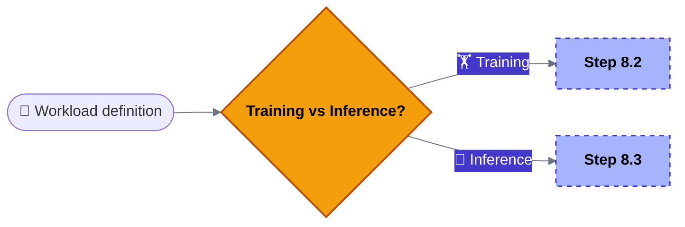
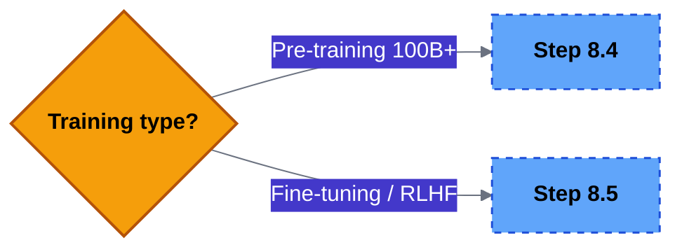
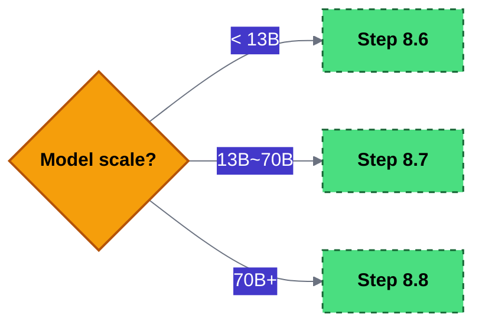
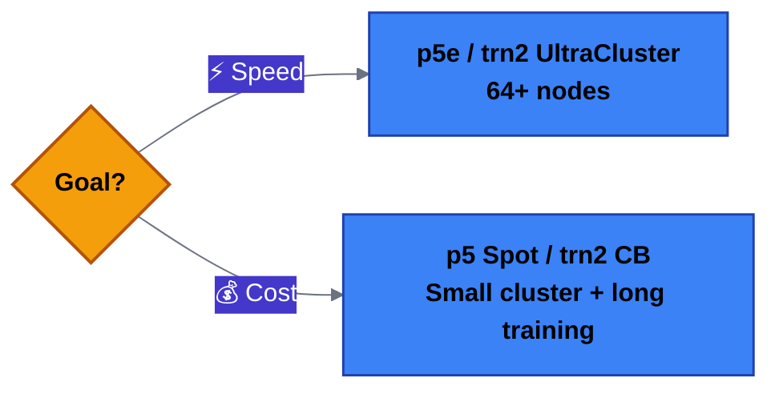
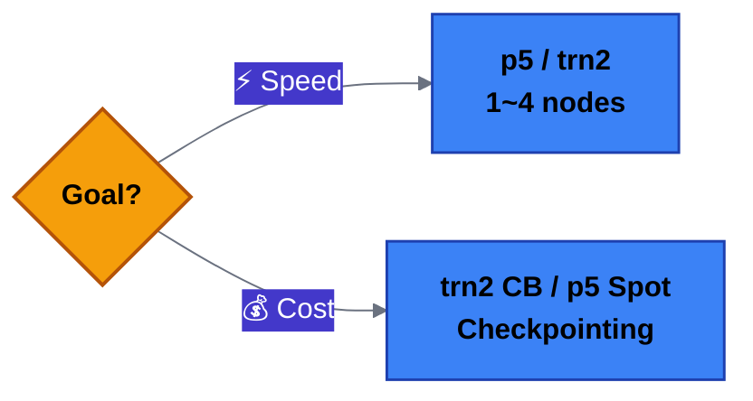
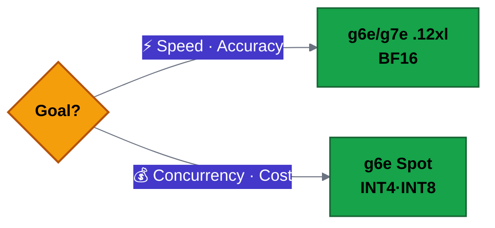
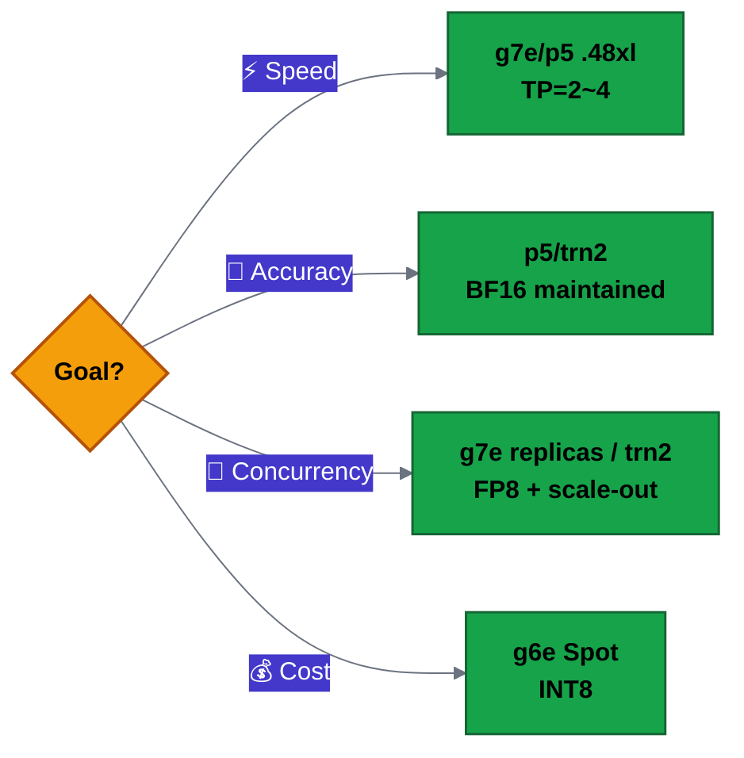
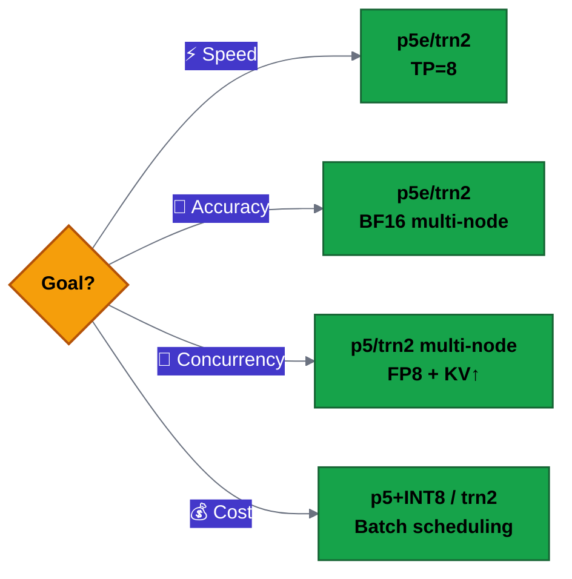
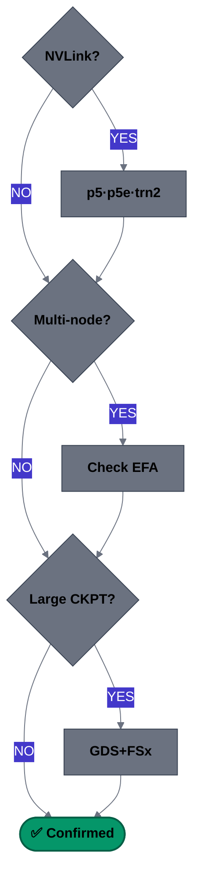

# Technical Guide to Selecting the Right Accelerator

Analyze the model and the hardware becomes clear. This guide provides a technical review framework spanning **workload → model analysis → accelerator matching**.

!!! info "Premise"
    This guide starts from the point where **the model has already been decided**. It focuses not on "Which model should I use?" but on "What hardware should I run this model on?"

## 1. Defining the Workload: Training or Inference

Because the compute and memory-access patterns of training and inference for large language models (LLMs) are completely different, academia and industry define the criteria for choosing an accelerator in strictly separate ways. [1, 2]

### The fundamental difference between training and inference

Academic papers (such as [A Review on Proprietary Accelerators for LLMs](https://arxiv.org/html/2503.09650v1)) characterize the workloads of the two tasks as follows. [3, 5]

- **Training (Compute-Bound)**: Performs both forward and backward computation over hundreds of billions of parameters and must continuously store gradients and optimizer state. Massive compute throughput (TFLOPS) and ultra-high-speed interconnect bandwidth between accelerators are the top priorities. [2, 6]
- **Inference (Memory-Bound)**: Based on already-frozen weights, it generates one token at a time sequentially. In particular, because of the KV Cache that stores information about previous tokens, memory bandwidth — rather than compute speed — becomes the bottleneck that determines performance. [6, 7]

| Selection criterion | Training | Inference |
|---------------|---------------|----------------|
| Core bottleneck | Compute capability and communication bandwidth | Memory bandwidth and read speed |
| Key hardware metric | TFLOPS, interconnect (NVLink, etc.) | HBM capacity (GB), memory bandwidth (GB/s) |
| Primary precision | FP16, BF16, FP8 (mixed precision) | INT8, INT4, FP4 (quantization scheme) |
| Priority value | Scalability and development generality | Low latency and cost efficiency per watt |

### Breaking down training

Even within "training," requirements differ completely depending on scale and stage.

| Type | Scale | Core bottleneck | Representative instances |
|------|------|----------|--------------|
| **Pre-training** | Hundreds to thousands of GPUs, weeks to months | Inter-node communication (gradient sync) | P5, P5e, Trn2 UltraCluster |
| **Fine-tuning** | 1–8 GPUs, hours to days | GPU memory (weights + optimizer) | P5, P4d, Trn1, G6e |
| **Fine-tuning (LoRA/QLoRA)** | 1 GPU possible, hours | Lower memory burden (train adapters only) | G6e, G7e also possible |
| **RLHF / Post-Training** | 4–32 GPUs | Memory + compute simultaneously (multiple models loaded) | P5, Trn2 |

**Core bottleneck details:**

- **Pre-training**: Since GPUs must exchange gradients with each other, EFA + NCCL (or EFA + Neuron CC) bandwidth determines throughput
- **Fine-tuning (Full)**: Model weights + optimizer state + gradients must all be loaded
- **Fine-tuning (LoRA/QLoRA)**: Only adapter parameters are trained → memory burden drops dramatically, single GPU possible
- **RLHF**: The Actor, Critic, Reference, and Reward models must be loaded onto the GPU simultaneously or sequentially

### Breaking down inference

Even within "inference," the optimal hardware differs depending on the serving pattern.

| Type | Characteristics | Core bottleneck | Representative instances |
|------|------|----------|--------------|
| **Real-time serving** | User-facing, low latency | Prefill (compute) + Decode (memory BW) | P5, G6e, G7e |
| **Batch processing** | Large volumes of documents, offline | GPU utilization (maximize throughput) | P5, Trn2 |
| **Embedding/classification** | Small models, high concurrency | Cost efficiency (handling concurrent requests) | G6, G6e |

**Core bottleneck details:**

- **Real-time serving**: The two stages have different bottlenecks
    - Prefill (prompt processing) → **compute-bound** — compute speed determines TTFT
    - Decode (token generation) → **memory-bandwidth-bound** — HBM bandwidth determines TPOT
- **Batch processing**: The key is to feed in large batches so the GPU is never idle
- **Embedding/classification**: The model is small enough that a single GPU can handle many requests → cost optimization is the deciding factor

### Hardware requirements comparison

| Criterion | Training | Inference |
|------|----------------|-----------------|
| Compute volume | Very high (forward + backward) | Medium (forward only) |
| Memory composition | Weights + optimizer + gradients | Weights + KV Cache |
| Inter-node network | Required (gradient sync) | A single node is usually sufficient |
| Storage I/O | High (checkpoints, data loading) | Low (only at model load) |
| Execution time | Hours to months (continuous) | Milliseconds to seconds (per request) |
| Cost structure | Favors long-term reservation (ODCR, Savings Plan) | Mix of On-Demand/Spot depending on traffic pattern |

### Decision flow

```
Model is decided
    │
    ├── Need training?
    │     ├── Pre-training (>10B) → Multi-node required → P5/Trn2 UltraCluster
    │     ├── Fine-tuning (Full)  → Single to few nodes → P5/P4d/Trn1
    │     ├── Fine-tuning (LoRA)  → Single GPU possible → G6e/G7e
    │     └── RLHF/DPO            → Multi-model load    → P5/Trn2
    │
    └── Inference serving?
          ├── Real-time + large model (70B+)   → Multi-GPU TP → P5/G7e
          ├── Real-time + mid model (7~13B)    → Single GPU   → G6e/G7e
          ├── Batch/offline                    → Throughput   → Trn2 (lower cost)
          └── Embedding/classification (small) → Cost-first   → G6
```

!!! tip "Practical judgment"
    Specify not just "training or inference" but **"which stage of training"** or **"which inference pattern."** Even within training, pre-training and LoRA fine-tuning differ by 100× in the number of GPUs required.

!!! note "References"
    [1] [A Review on Proprietary Accelerators for LLMs](https://arxiv.org/html/2503.09650v1) (arXiv, 2025)  
    [2] [Commercial Accelerator Technology Trends for Large Language Model Acceleration](https://www.kci.go.kr/kciportal/ci/sereArticleSearch/ciSereArtiView.kci?sereArticleSearchBean.artiId=ART003212940) (KCI)  
    [3] [AI Accelerators for Large Language Model Inference](https://arxiv.org/pdf/2506.00008) (arXiv, 2025)  

## 2. Choosing an Accelerator by Model Architecture

A model's architecture fundamentally changes the resources it demands from an accelerator. Start with the summary table below, then consult the detailed guidance. (All model names below are **examples**, and the same criteria apply to other models with the same architecture.)

### Summary of accelerator requirements by architecture

| Architecture | 1st bottleneck | 2nd bottleneck | Parallelization strategy | AWS instance (NVIDIA) | AWS instance (Neuron) |
|----------|-----------|-----------|------------|---------------------|---------------------|
| **LLM Dense** | Compute (TFLOPS) | Intra-node comm. (NVLink) | Tensor Parallelism | p5.48xl, p5e.48xl, g7e | trn2.48xl |
| **LLM MoE** | Memory capacity (GB) | Inter-node comm. (EFA) | Expert Parallelism | p5e.48xl (large HBM) | trn2.48xl (1.5TB HBM) |
| **Vision FM** | Compute + memory bandwidth | Batch-size scalability | Data Parallelism | p5.48xl (training), g6e/g7e (inference) | trn2.48xl |
| **Traditional CV (CNN)** | Compute (FP32/TF32) | Memory bandwidth | Data Parallelism | g6e (inference), p5.48xl (training) | trn2.3xl (inference) |
| **Audio/Speech** | Memory bandwidth | Latency | Data Parallelism | g6e, g7e | trn2.3xl (inference) |
| **Traditional ML** | CPU/memory bandwidth | I/O throughput | Data Parallelism | g6e (small scale) | Not applicable (CPU recommended) |

### LLM Dense — details

Representative models (examples): Llama 3/4, Qwen3-Dense, Gemma 4, GLM-5

In a Dense model, input tokens pass through **all parameters (100%)**. Compute density is high and memory access is regular, making it the structure with the highest hardware utilization.

**Keys to accelerator selection:**

| Requirement | Description |
|----------|------|
| High compute density | Parameter count = compute volume. TFLOPS is performance |
| Tensor Parallelism efficiency | All-Reduce at every layer → intra-node NVLink/NVSwitch bandwidth matters |
| Regular memory access | High HBM bandwidth efficiency. If model > HBM capacity, TP splitting is required |

| Workload | AWS instance (NVIDIA) | AWS instance (Neuron) |
|----------|---------------------|---------------------|
| Training (pre-training/fine-tuning) | p5.48xlarge (H100×8), p5e.48xlarge (H200×8) | trn2.48xlarge |
| Inference (quality first) | p5.48xlarge, g7e.48xlarge | trn2.48xlarge |
| Inference (cost first) | g6e.48xlarge, g7e.xlarge~48xlarge | trn2.3xlarge |

### LLM MoE — details

Representative models (examples): DeepSeek-V3/R1, Kimi-K2, Qwen3-MoE, Mixtral

MoE activates **only a small subset of experts** (3–26% per token) out of hundreds of billions to trillions of parameters. The compute is small, but all experts must reside in memory.

| Model | Total parameters | Active parameters | Active ratio |
|------|:-----------:|:-----------:|:---------:|
| DeepSeek-V3 | 671B | 37B | ~5.5% |
| Kimi-K2 | 1T+ | ~32B | ~3% |
| Qwen3-MoE (A22B) | 235B | 22B | ~9% |
| Mixtral 8×7B | 47B | 12B | ~26% |

**Keys to accelerator selection:**

| Requirement | Description |
|----------|------|
| Extreme memory capacity | All experts reside in HBM. DeepSeek-V3 BF16 = ~1.3TB |
| Expert Parallelism + inter-node comm. | All-to-All routing → EFA network bandwidth is the bottleneck |
| Dynamic load balancing | Guard against expert skew → a mature software ecosystem is needed |

| Workload | AWS instance (NVIDIA) | AWS instance (Neuron) |
|----------|---------------------|---------------------|
| Training | p5e.48xlarge (H200 141GB×8=1.1TB) multi-node | trn2.48xlarge (1.5TB) multi-node |
| Inference | p5e.48xlarge multi-node, g7e.48xlarge multi-node | trn2.48xlarge |

!!! tip "How to tell Dense vs MoE"
    If `config.json` has a `num_experts` field it's MoE; if not, it's Dense:
    ```json
    {
      "model_type": "deepseek_v3",
      "num_experts": 256,
      "num_experts_per_tok": 8
    }
    ```

### Dense vs MoE comparison

| Comparison item | Dense | MoE |
|----------|-------|-----|
| 1st accelerator priority | Compute (TFLOPS) | Memory capacity (GB) |
| Communication bottleneck | Intra-node (NVLink) | Inter-node (EFA) |
| Communication pattern | All-Reduce | All-to-All |
| Hardware efficiency | Very high (100% utilization) | Relatively low (idle memory) |
| Throughput at equal quality | Baseline | 2–4× advantage (less active compute) |

### Vision / CV / Audio / Traditional ML — summary

| Architecture | Representative models (examples) | Compute characteristics | AWS instance (NVIDIA) | AWS instance (Neuron) | One-line verdict |
|----------|-----------------|----------|---------------------|---------------------|-----------|
| **Vision FM** | CLIP, DINOv2, SAM, SD3 | Large image batches × Transformer compute. VRAM-intensive | p5.48xl (training) / g6e, g7e (inference) | trn2.48xl (training) | Balance HBM capacity + TFLOPS. Image resolution determines memory |
| **Traditional CV (CNN)** | ResNet, YOLO, EfficientNet, U-Net | Conv-centric. Relatively small model size | g6e (inference), p5.48xl (training) | trn2.3xl (inference) | Fits on a single GPU. Scale batches with Data Parallelism |
| **Audio/Speech** | Whisper, TTS, Bark | Sequential-decoding-centric. Small model but latency-sensitive | g6e, g7e (low latency) | trn2.3xl (cost efficient) | Latency SLA is the selection criterion. Mostly fits on a single chip |
| **Traditional ML** | XGBoost, TabNet, DLRM | CPU-bound or embedding-table memory-intensive | g6e (DLRM training) / CPU instances | Not applicable | First decide whether a GPU is needed. XGBoost/LightGBM are more cost-effective on CPU |

!!! note "Why are Vision/Audio different from LLMs?"
    - **Relatively small model size**: Even ViT-G is only ~4B → fits on a single GPU
    - **Batch scaling is key**: During training, images/audio are processed in large parallel batches → Data Parallelism is the primary strategy
    - **TP unnecessary**: Since the model fits on a single chip, there is almost no inter-GPU communication bottleneck
    - Therefore, you can estimate simply as **GPU count = throughput target / per-GPU throughput**

### Practical judgment flow

```
What is my model?
│
├─ LLM (Transformer Decoder)
│   ├─ num_experts in config.json? → MoE → Memory capacity first (p5e.48xl / trn2.48xl)
│   └─ None → Dense → Compute first (p5.48xl / g7e / trn2)
│
├─ Vision/Multimodal (ViT, Diffusion, etc.)
│   └─ Model < 10B → Fits on a single GPU → scale with g6e/g7e + Data Parallelism
│
├─ CNN (detection/classification/segmentation)
│   └─ Model < 1B → Single GPU is enough → for inference, trn2.3xl/g6e for cost efficiency
│
├─ Audio (Whisper, TTS)
│   └─ Check latency SLA → single-chip low latency first
│
└─ Traditional ML (XGBoost, recommendation)
    └─ Is a GPU needed? → GPU if embeddings are large, otherwise CPU
```

!!! note "References"
    [1] [Mixture-of-Experts for LLMs: A Survey](https://arxiv.org/abs/2407.21774) (arXiv, 2024)  
    [2] [DeepSeek-V3 Technical Report](https://arxiv.org/abs/2412.19437) (arXiv, 2024)  
    [3] [A Review on Proprietary Accelerators for LLMs](https://arxiv.org/html/2503.09650v1) (arXiv, 2025)  


## 3. Data Types & Quantization Strategy

Each accelerator natively supports different numerical precisions (FP32, BF16, FP8, INT4, etc.). If the hardware cannot natively handle the data type the model requires, software emulation causes **throughput to drop below half, or deployment to become impossible altogether**. Therefore, deciding "what precision to train/infer in" first, then choosing an instance that natively supports that data type, is a key axis of accelerator selection.

### NVIDIA GPU data-type support by generation

<table>
<thead>
<tr>
  <th>Instance</th>
  <th>G5<br><code>A10G</code></th>
  <th>P4d/P4de<br><code>A100</code></th>
  <th>G6e<br><code>L40S</code></th>
  <th>P5/P5e/P5en<br><code>H100/H200</code></th>
  <th>G7e<br><code>RTX PRO 6000</code></th>
  <th>P6<br><code>B200/B300</code></th>
</tr>
<tr>
  <th>Architecture</th>
  <th colspan="2"><code>Ampere</code></th>
  <th><code>Ada</code></th>
  <th><code>Hopper</code></th>
  <th colspan="2"><code>Blackwell</code></th>
</tr>
</thead>
<tbody>
<tr><td><strong>FP32</strong></td><td>✅</td><td>✅</td><td>✅</td><td>✅</td><td>✅</td><td>✅</td></tr>
<tr><td><strong>TF32</strong></td><td>✅</td><td>✅</td><td>✅</td><td>✅</td><td>✅</td><td>✅</td></tr>
<tr><td><strong>FP16</strong></td><td>✅</td><td>✅</td><td>✅</td><td>✅</td><td>✅</td><td>✅</td></tr>
<tr><td><strong>BF16</strong></td><td>✅</td><td>✅</td><td>✅</td><td>✅</td><td>✅</td><td>✅</td></tr>
<tr><td><strong>INT8</strong></td><td>✅</td><td>✅</td><td>✅</td><td>✅</td><td>✅</td><td>✅</td></tr>
<tr><td><strong>FP8</strong> (E4M3/E5M2)</td><td>❌</td><td>❌</td><td>✅</td><td>✅</td><td>✅</td><td>✅</td></tr>
<tr><td><strong>INT4</strong></td><td>❌</td><td>❌</td><td>✅</td><td>✅</td><td>✅</td><td>✅</td></tr>
<tr><td><strong>FP4</strong> (NVFP4)</td><td>❌</td><td>❌</td><td>❌</td><td>❌</td><td>✅</td><td>✅</td></tr>
<tr><td><strong>MXFP8</strong></td><td>❌</td><td>❌</td><td>❌</td><td>❌</td><td>✅</td><td>✅</td></tr>
<tr><td><strong>Sparsity</strong> (2:4 structured)</td><td>❌</td><td>✅</td><td>✅</td><td>✅</td><td>✅</td><td>✅</td></tr>
</tbody>
</table>

### AWS AI Chip data-type support

<table>
<thead>
<tr>
  <th>Instance</th>
  <th>Trn1/Trn1n<br><code>Trainium</code></th>
  <th>Trn2<br><code>Trainium2</code></th>
  <th>Trn3<br><code>Trainium3</code></th>
</tr>
<tr>
  <th>Architecture</th>
  <th><code>NeuronCore-v2</code></th>
  <th><code>NeuronCore-v3</code></th>
  <th><code>NeuronCore-v4</code></th>
</tr>
</thead>
<tbody>
<tr><td><strong>FP32</strong></td><td>✅</td><td>✅</td><td>✅</td></tr>
<tr><td><strong>TF32</strong></td><td>✅</td><td>✅</td><td>✅</td></tr>
<tr><td><strong>FP16</strong></td><td>✅</td><td>✅</td><td>✅</td></tr>
<tr><td><strong>BF16</strong></td><td>✅</td><td>✅</td><td>✅</td></tr>
<tr><td><strong>FP8</strong></td><td>✅ (cFP8)</td><td>✅</td><td>✅ (MXFP8)</td></tr>
<tr><td><strong>FP4</strong></td><td>❌</td><td>❌</td><td>✅ (MXFP4)</td></tr>
<tr><td><strong>INT8</strong></td><td>✅</td><td>—</td><td>—</td></tr>
<tr><td><strong>Stochastic Rounding</strong></td><td>✅</td><td>✅</td><td>✅</td></tr>
<tr><td><strong>Sparsity</strong> (structured)</td><td>❌</td><td>✅</td><td>✅</td></tr>
</tbody>
</table>

### Data type → hardware decision examples

| Scenario | Required data type | Possible hardware | Impossible hardware |
|----------|----------------|---------------|----------------|
| FP8-quantized 70B inference | FP8 | P5/P5e/P5en (H100/H200), G6e (L40S), G7e (RTX PRO 6000), Trn2 | P4d/P4de (A100), G5 (A10G) |
| FP4-quantized 405B inference | FP4 (NVFP4/MXFP4) | **P6 (B200/B300), G7e (RTX PRO 6000), Trn3** | Everything P5 and below, Trn1/Trn2 |
| BF16 training + Stochastic Rounding | BF16 + SR | Trn1/Trn1n, Trn2, Trn3 | All NVIDIA (SR not supported) |
| 2:4 Structured Sparsity inference | Sparsity | P4d/P4de (A100), P5/P5e/P5en (H100/H200), G7e, P6, Trn2, Trn3 | G5 (A10G), Trn1 |
| INT8 lightweight model serving | INT8 | G5, G6e, P4d/P4de, P5/P5e/P5en, G7e, P6, Trn1 | — |

!!! tip "Practical judgment flow"
    1. Confirm the model's training/inference precision (model card, `torch_dtype` in config.json)
    2. If applying quantization, decide the target precision (FP8? INT4? FP4?)
    3. From the matrix above, filter to **hardware that natively supports that data type**

### How to check a model's data type

Before choosing an accelerator, you must first confirm **what precision the model you intend to use was trained in**.

#### How to check

| Method | Location | What to check |
|------|------|----------|
| **config.json** | Root of the HuggingFace model repo | `"torch_dtype": "bfloat16"` |
| **Model card (README)** | HuggingFace Model Card | "Training precision", "dtype" notation |
| **File extension/path** | Checkpoint file name | Suffixes like `-fp8`, `-awq`, `-gptq` |
| **Check in code** | Python | `model.config.torch_dtype` or `model.dtype` |

```python
# Example: check the training precision of a HuggingFace model
from transformers import AutoConfig
config = AutoConfig.from_pretrained("meta-llama/Llama-3.3-70B-Instruct")
print(config.torch_dtype)  # → torch.bfloat16
```

### The relationship between training precision and inference precision

**Key question**: "Must a model trained in BF16 be inferred in BF16?"

**Answer: No.** You can infer at a precision **equal to or lower than** the training precision. There are, however, conditions.

| Training precision | Possible inference precision | Condition |
|:-----------:|:---------------:|------|
| BF16 | **BF16** | Use as-is — no accuracy loss |
| BF16 | **FP8** | Apply Post-Training Quantization (PTQ). Very small accuracy loss (<0.5%) |
| BF16 | **INT4** (AWQ/GPTQ) | PTQ required. Calibration data required. Accuracy loss ~1-3% |
| BF16 | **FP4** | Requires native Blackwell/Trn3 support. Latest quantization technique |
| FP8 | **FP8** | Use as-is |
| FP8 | **INT4** | Further quantization possible, but beware of cumulative accuracy loss |

#### Training and inference — why are the requirements different?

| | Training | Inference |
|--|--|--|
| **Core requirement** | Gradient stability, convergence guarantee | Throughput, latency |
| **Precision criterion** | Higher is more stable (BF16 is the standard) | Lower is more efficient within the acceptable quality range |
| **Typical choice** | BF16 (Mixed Precision: FP32 master + BF16 compute) | BF16 → FP8 → INT4 depending on model/service requirements |
| **Changing data type** | Hard to change during training (decided from the start) | Can be freely lowered afterward via PTQ |

!!! tip "Practical judgment flow"
    1. Confirm the model's training precision in `config.json` (usually BF16)
    2. **Training**: Keep the same precision → you need hardware that natively supports that data type
    3. **Inference**: Decide the target precision (quality vs cost trade-off) → choose hardware that natively supports that quantization
    4. Without native support, software emulation offers no performance benefit (exclude the candidate)

## 4. Memory Sizing & Capacity Planning {#memory-sizing}

### Memory composition formula

```
Total GPU memory = Model weights + KV Cache + Activation Memory
```

#### Model weights

```
Weight memory = Number of parameters × bytes/parameter
```

| Precision | Bytes/parameter | For a 70B model |
|--------|---------------|--------------|
| FP32 | 4 bytes | 280 GB |
| FP16 / BF16 | 2 bytes | 140 GB |
| INT8 / FP8 | 1 byte | 70 GB |
| INT4 / NF4 | 0.5 byte | 35 GB |

#### KV Cache (the hidden cost)

During inference, the KV Cache is as important as the model weights. Every time a token is generated, the Key/Value tensors of previous tokens must be stored, and this grows in proportion to **number of concurrent requests × context length**.

**KV Cache formula:**

```
KV Cache (bytes) = 2 × num_layers × num_kv_heads × head_dim × sequence_length × bytes_per_element × batch_size
```

- `2`: Key and Value each stored
- `num_layers`: Number of Transformer layers
- `num_kv_heads`: Number of KV heads (fewer than Query heads when using GQA)
- `head_dim`: Head dimension (= hidden_size / num_attention_heads)
- `sequence_length`: Maximum context length
- `bytes_per_element`: Bytes per data type (BF16=2, FP8=1)
- `batch_size`: Number of concurrently processed requests

#### Practical example: computing the KV Cache for Llama 3.3 70B

Llama 3.3 70B spec: `num_layers=80`, `num_kv_heads=8` (GQA), `head_dim=128`

```
KV Cache per request (BF16, 4K context):
= 2 × 80 × 8 × 128 × 4,096 × 2 bytes
= 1.07 GB / request
```

| Context length | 1 concurrent request | 16 concurrent | 64 concurrent | 128 concurrent |
|:------------:|:-----------:|:---------:|:---------:|:----------:|
| 4K | 1.07 GB | 17.2 GB | 68.7 GB | 137.4 GB |
| 8K | 2.15 GB | 34.4 GB | 137.4 GB | 274.9 GB |
| 32K | 8.59 GB | 137.4 GB | 549.8 GB | 1,099 GB |
| 128K | 34.4 GB | 549.8 GB | 2,199 GB | 4,398 GB |

!!! warning "The KV Cache can grow larger than the weights"
    For Llama 3.3 70B (BF16 weights = 140GB), even just 8K context × 64 concurrent requests makes the KV Cache (137GB) rival the weights. Long context + high concurrency = the main culprit of memory explosion.

#### Estimating total memory

```
Total required memory = Model weights + KV Cache + Activation/Framework overhead (~5-10%)
```

| Component (Llama 3.3 70B, BF16) | Memory |
|------|--------|
| Model weights | 140 GB |
| KV Cache (8K context × 32 concurrent) | ~69 GB |
| Activation + Framework overhead | ~10 GB |
| **Total** | **~219 GB** |

### Throughput-based capacity planning

This is the step of mapping the total memory computed above to accelerators.

#### Step 1: Required number of accelerators (memory basis)

```
Minimum accelerators = ⌈ Total required memory / HBM capacity per accelerator ⌉
```

| Accelerator | HBM capacity | Minimum count for the example above (219GB) |
|--------|:--------:|:-------------------------:|
| H100 SXM | 80 GB | ⌈219/80⌉ = **3 cards** (TP=4 recommended) |
| H200 SXM | 141 GB | ⌈219/141⌉ = **2 cards** (TP=2) |
| B200 SXM | 192 GB | ⌈219/192⌉ = **2 cards** (TP=2) |
| NeuronCore v3 (trn2.48xl) | 1,536 GB (total) | **1 instance** (TP=8~16) |
| NeuronCore v3 (trn2.3xl) | 96 GB | ⌈219/96⌉ = **3 instances** (multi-node) |

#### Step 2: Scale out based on throughput target

Even with enough memory, you may need additional accelerators to achieve the target throughput (tokens/sec).

```
Required instances = ⌈ Target throughput / Throughput per instance ⌉ × HA factor
```

| Item | Description | Example |
|------|------|------|
| Target throughput | Based on service SLA (e.g., 5,000 tokens/sec at peak) | 5,000 tok/s |
| Throughput per instance | Benchmarked value (varies by model, batch, quantization) | ~2,500 tok/s (H100 FP8) |
| HA factor | High-availability headroom (rolling update, failover) | ×2 |
| **Result** | | ⌈5000/2500⌉ × 2 = **4 instances** |

#### Step 3: Final decision — the larger of memory vs throughput

```
Final accelerator count = max(memory-based count, throughput-based count)
```

!!! tip "Practical checklist"
    1. Confirm `num_layers`, `num_kv_heads`, `head_dim` in `config.json`
    2. Define service requirements: maximum context length, peak concurrent requests
    3. Compute memory with the KV Cache formula
    4. Total memory → determine the minimum number of accelerators
    5. Target throughput → determine the scale-out count
    6. The larger of the two + HA headroom = final infrastructure size


## 5. Performance Metrics Explained — Inference & Training

This is foundational knowledge for the "workload → accelerator matching" decisions in Section 6. It organizes **what each metric measures, which hardware resource determines it, and what level the industry uses as a benchmark**.

!!! info "What are P50 / P99?"
    **Percentile** — when all requests are sorted by latency, the maximum delay experienced by requests up to that percentage.

    - **P50 (= median)**: 50% of all requests complete within this time. "The average user experience"
    - **P99**: 99% of all requests complete within this time. Only the remaining 1% is slower. "The delay experienced by the worst 1% of users"

    In production, **SLAs are set based on P99**. Even if P50 is good, a bad P99 means 1% of users wait several seconds or more, which directly leads to service dissatisfaction.

### Inference performance metrics

#### TTFT (Time to First Token)

The time from when the user sends a request until **the first token arrives** (ms).

- **Physical meaning**: Time spent in the Prefill stage. The stage that processes the entire input prompt at once to generate the KV Cache
- **Determining resource**: **Compute (Compute-bound)** — directly governed by GPU TFLOPS
- **Influencing factors**: Input length (number of prompt tokens), degree of Tensor Parallelism, batching strategy (Chunked Prefill)
- **Felt experience**: The point where the user feels "I pressed the button but no response is coming." Most directly tied to UX

| Grade | P50 basis | P99 basis | Applicable scenario |
|:----:|:--------:|:--------:|:------------:|
| Excellent | < 200ms | < 500ms | Real-time chatbot, copilot |
| Good | 200~500ms | 500ms~1s | General conversational service |
| Acceptable | 500ms~2s | 2~5s | Asynchronous processing, batch |
| Risky | > 2s | > 5s | User-abandonment threshold |

!!! warning "P50 vs P99"
    Industry standard: even if P50 looks like 400ms, a P99 of 4 seconds or more violates the production SLA. Always set targets based on **P99**. [1]

#### TPOT / ITL (Time per Output Token / Inter-Token Latency)

The **interval** between consecutively generated tokens (ms/token).

- **Physical meaning**: The Decode stage. The stage that, for each token, reads the KV Cache to predict the next token
- **Determining resource**: **Memory bandwidth (Memory-bandwidth-bound)** — directly governed by HBM bandwidth (GB/s)
- **Influencing factors**: Model size, KV Cache size, batch size (larger batch → higher per-request TPOT), quantization level
- **Felt experience**: The "characters coming out one by one in stutters" feeling during streaming responses = a state of high TPOT

| Grade | TPOT (ms) | Felt speed | Note |
|:----:|:---------:|:---------:|:----:|
| Excellent | < 30ms | Exceeds human reading speed (~33 tok/s) | Optimal for real-time streaming |
| Good | 30~60ms | Natural streaming (~17 tok/s) | Most production |
| Acceptable | 60~100ms | Slow but acceptable (~10 tok/s) | Long-context large models |
| Risky | > 100ms | Noticeable delay (< 10 tok/s) | Clear UX degradation |

#### Throughput

The **total number of tokens** a system generates per unit time (tokens/sec). A whole-system view, not a single request.

- **Physical meaning**: The productivity of the entire system processing many batched requests simultaneously
- **Determining resource**: GPU utilization × batching efficiency × memory headroom (number of concurrent requests the KV Cache can hold)
- **Influencing factors**: Continuous Batching, PagedAttention, memory capacity, GPU count
- **Key**: Higher throughput = more concurrent users = better infrastructure cost efficiency

| Scale | Throughput per GPU (example) | Description |
|------|:-----------------:|------|
| High efficiency | > 3,000 tok/s | FP8 quantization + Continuous Batching + large batch |
| Typical | 1,000~3,000 tok/s | BF16/FP16, normal batching |
| Low efficiency | < 1,000 tok/s | Single-request processing, no quantization |

#### TTFT vs TPOT — why are they different problems?

| | TTFT (Prefill) | TPOT (Decode) |
|--|:--------------:|:-------------:|
| Bottleneck | Compute-bound | Memory-bandwidth-bound |
| Core resource | TFLOPS | HBM bandwidth (GB/s) |
| Input effect | Proportional to prompt length | Independent of output length (fixed per token) |
| Optimization direction | TP scaling, Chunked Prefill | Quantization, Speculative Decoding |
| Instance choice | High-compute (p5.48xl, trn2.48xl) | High-bandwidth (H200, B200 = high HBM bandwidth) |

!!! tip "Prefill-Decode disaggregation (Disaggregated Serving)"
    A recent industry trend: handle Prefill and Decode in separate instance pools. Prefill on high-compute (p5.48xl), Decode on high-bandwidth (p5e.48xl) — matching hardware optimized for each stage improves cost efficiency.

### Training performance metrics

#### MFU (Model FLOPs Utilization)

During training, the **ratio of the GPU's theoretical peak compute actually used for useful computation** (%).

```
MFU = (theoretical FLOPs/sec needed for model training) / (GPU hardware Peak TFLOPS)
```

- **Meaning**: "How well am I utilizing my GPU?" — expresses the efficiency of the training recipe (parallelization, batching, communication) in a single number
- **Industry benchmark values**:

| MFU range | Rating | Representative case |
|:--------:|:----:|:---------:|
| 55~75% | Best-in-class | Large lab pre-training (Google PaLM: 46~57%, Meta Llama 3: ~38~43%) |
| 40~55% | Excellent | Well-tuned distributed training pipeline |
| 30~40% | Average | Typical fine-tuning, small clusters |
| < 30% | Inefficient | Communication bottleneck, pipeline bubbles, improper batch size |

- **Factors that lower MFU**: Pipeline bubbles (when using PP), communication waits (TP/DP All-Reduce), Activation Recomputation, small batch size, inefficient data loading
- **How to raise MFU**: Larger batch size, Flash Attention, overlapping (communication + compute), using high-bandwidth NVLink/EFA

!!! note "A caveat on interpreting MFU"
    MFU is based on **matmul operations only**. Attention softmax, LayerNorm, Optimizer step, etc. are excluded from "useful computation." Therefore 100% is theoretically impossible, and 60% means you are doing very well. [2, 3]

#### Communication Efficiency

In distributed training, the **ratio of communication overhead relative to compute**.

```
Communication efficiency = Compute time / (Compute time + Communication wait time)
```

| Communication type | Where it occurs | Determining resource | Target |
|----------|----------|----------|:----:|
| All-Reduce (TP) | Every layer | NVLink bandwidth | > 90% |
| All-Reduce (DP) | Every step (gradient sync) | EFA bandwidth | > 85% |
| All-to-All (EP) | MoE routing | Inter-node network | > 80% |
| P2P Send/Recv (PP) | Between pipeline stages | NVLink/EFA | > 85% |

- **Signs of low communication efficiency**: GPU Utilization is high but MFU is low → during communication waits the GPU may look non-idle, but is actually not doing useful computation
- **Improvement direction**: Gradient Accumulation (fewer communication rounds), communication-compute overlapping, choosing a parallelization strategy that fits the network topology

### Relationships among metrics — the full picture

```
┌─────────────────────────────────────────────────┐
│                   Inference                       │
├─────────────────────────────────────────────────┤
│  User-perceived      System efficiency            │
│  ┌──────┐          ┌───────────┐                │
│  │ TTFT │──────────│ Prefill   │← Compute-bound │
│  └──────┘          │ Compute   │                 │
│  ┌──────┐          ├───────────┤                │
│  │ TPOT │──────────│ Decode    │← Memory BW     │
│  └──────┘          │ Bandwidth │                 │
│  ┌──────────┐      ├───────────┤                │
│  │Throughput│──────│ Batching  │← GPU util.     │
│  └──────────┘      └───────────┘                │
├─────────────────────────────────────────────────┤
│                   Training                        │
├─────────────────────────────────────────────────┤
│  ┌──────┐                                       │
│  │ MFU  │── GPU compute efficiency (matmul)      │
│  └──────┘                                       │
│  ┌──────────┐                                   │
│  │Comm. eff.│── Distributed training overhead    │
│  └──────────┘                                   │
└─────────────────────────────────────────────────┘
```

!!! note "References"
    [1] [LLM Inference SLO Engineering: TTFT, ITL, and P99 Latency Budgets](https://www.spheron.network/blog/llm-inference-slo-ttft-itl-latency-budget-guide-2026/) (Spheron, 2026)  
    [2] [Model FLOPs Utilization — The GPU Efficiency Metric](https://zeroentropy.dev/concepts/mfu/) (ZeroEntropy, 2026)  
    [3] [NVIDIA H100 Benchmarks: What We Learned from Large-Scale GPU Testing](https://coreweave.com/blog/nvidia-h100-gpu-benchmark-results-what-we-learned-from-large-scale-gpu-testing) (CoreWeave, 2026)  
    [4] [LLM Inference Benchmarking: Fundamental Concepts](https://developer.nvidia.com/blog/llm-benchmarking-fundamental-concepts) (NVIDIA, 2025)  

## 6. Workload → Accelerator Matching

Once you understand the metrics in Section 5, you now decide **"based on my service's top priority, which metric do I optimize, and which instance do I choose?"**

### Defining the service goal

Before choosing an accelerator, first pick a single **top priority** for the workload. Optimizing all metrics at once is impossible — trade-offs exist.

| # | Service goal | Key question | Representative scenario |
|:-:|:----------:|----------|:------------:|
| ① | **Response speed (Latency SLA)** | "Within how many ms must the user receive the first response?" | Real-time chatbot, copilot, voice AI |
| ② | **Accuracy (Quality)** | "Quantization/compression lowers quality — how much can you tolerate?" | Medical reading, legal document analysis, code generation |
| ③ | **Maximum concurrency (Concurrency)** | "Can you serve N concurrent users within SLA at peak?" | B2C service, high-traffic API |
| ④ | **Cost efficiency (Cost/Token)** | "How do you minimize cost per token?" | Batch processing, internal tools, classification/summarization |
| ⑤ | **Training speed (Time-to-Train)** | "Must the model finish training within days/weeks?" | Pre-training, large-scale fine-tuning |
| ⑥ | **Training cost efficiency (Cost/MFU)** | "How do you extract maximum MFU on a limited budget?" | Startup fine-tuning, research experiments |

### Goal → priority metric → optimization direction → instance matching

#### ① Response speed first (Latency SLA)

> "Must guarantee P99 TTFT < 500ms, TPOT < 40ms"

| Priority metric | Optimization direction | Trade-off |
|----------|-----------|:----------:|
| TTFT (P99) | Maximize Prefill compute speed | Throughput↓, cost↑ |
| TPOT (P99) | Maximize Decode bandwidth | Batch size limited |

**Hardware strategy:**
- High-compute + high-bandwidth instances: keep large models in FP16/BF16 (minimize quantization)
- Tensor Parallelism scaling: TP=2~4 to shorten Prefill time
- Batch size limit: limit concurrent requests to guarantee individual latency
- Prefill-Decode separation: a Prefill-only pool (high compute) + a Decode-only pool (high bandwidth)

| Model scale | AWS instance (NVIDIA) | AWS instance (Neuron) | Note |
|:---------:|:-------------------:|:-------------------:|------|
| < 13B | g6e.12xlarge (1~2 GPU) | trn2.3xlarge | Low latency on single/2 GPU |
| 13B~70B | g7e.48xlarge, p5.48xlarge | trn2.48xlarge | TP=2~4 |
| 70B+ | p5.48xlarge, p5e.48xlarge | trn2.48xlarge | TP=8, multi-node possible |

#### ② Accuracy first (Quality)

> "Must serve at the original precision (BF16/FP16) without quantization. Response quality must exceed the business threshold"

| Priority metric | Optimization direction | Trade-off |
|----------|-----------|:----------:|
| Maintain model quality | Keep BF16, choose a large model | Memory usage↑, cost↑ |
| TPOT (within quality-preserving range) | Speculative Decoding (lossless quality acceleration) | Implementation complexity↑ |

**Hardware strategy:**
- **No quantization → memory capacity first**: enough HBM to load the entire BF16 model
- **Larger model = higher accuracy**: within the same family, 70B > 8B quality → an instance that can hold the large model
- FP8 has minimal quality loss (< 1% benchmark degradation) and can cut cost — but domain-specific validation is required

| Model scale | AWS instance (NVIDIA) | AWS instance (Neuron) | Note |
|:---------:|:-------------------:|:-------------------:|------|
| 70B BF16 | p5.48xlarge (640GB) | trn2.48xlarge (1.5TB) | Load entire model in BF16 |
| 400B+ BF16 | p5e.48xlarge multi-node | trn2.48xlarge multi-node | Needs HBM 1TB+ |
| 70B FP8 (after quality validation) | g7e.48xlarge (768GB) | trn2.48xlarge | One node possible with FP8 quantization |

!!! tip "Accuracy and latency together"
    Speculative Decoding: a small Draft model quickly generates candidates → the large model verifies them. 0% quality loss, 2~3× faster. However, extra memory is needed for the Draft model.

#### ③ Maximum concurrency first (Concurrency)

> "Must handle 1,000 concurrent users at peak with P99 TTFT < 2s"

| Priority metric | Optimization direction | Trade-off |
|----------|-----------|:----------:|
| Throughput (tok/s) | Maximize batching, optimize KV Cache | Individual TPOT↑ |
| Concurrent requests | KV Cache memory = concurrency ceiling | Memory cost↑ |

**Hardware strategy:**
- **KV Cache determines the concurrency ceiling** (see Section 4): accelerator memory − model weights = KV Cache headroom → maximum concurrent requests
- INT8/FP8 quantization shrinks the model → more KV Cache headroom → higher concurrency
- PagedAttention + Continuous Batching are essential
- Horizontal scaling: GPU count × per-GPU throughput = total throughput

| Model scale | AWS instance (NVIDIA) | AWS instance (Neuron) | Note |
|:---------:|:-------------------:|:-------------------:|------|
| 8B INT8 | g6e.48xlarge (many replicas) | trn2.3xlarge (many replicas) | Small model + replica scale-out |
| 70B FP8 | p5.48xlarge, g7e.48xlarge | trn2.48xlarge | Maximize KV Cache headroom |
| 70B+ large-scale | p5e.48xlarge multi-node | trn2.48xlarge multi-node | Total HBM = concurrency ceiling |

#### ④ Cost efficiency first (Cost/Token)

> "Must minimize cost per token. Latency SLA is loose (TTFT < 5s allowed)"

| Priority metric | Optimization direction | Trade-off |
|----------|-----------|:----------:|
| $/1M tokens | Aggressive quantization (INT4/GPTQ), Spot instances | Quality slightly↓, latency↑ |
| GPU utilization | Large batch + high GPU Utilization | Individual latency↑ |

**Hardware strategy:**
- INT4/AWQ quantization: 4× model size reduction → can serve on low-cost GPUs
- Spot instances: 70~90% discount. Suited to batch processing/non-real-time workloads
- Small instance + large batch: maximize batch size on the g6e.xlarge~12xlarge class
- Neuron (trn2): can cut $/tok by 30~50% vs NVIDIA (assuming compile optimization)

| Model scale | AWS instance (NVIDIA) | AWS instance (Neuron) | Note |
|:---------:|:-------------------:|:-------------------:|------|
| 8B INT4 | g6e.xlarge~2xlarge (Spot) | trn2.3xlarge | Lowest cost, single GPU |
| 70B INT4 | g6e.48xlarge (Spot) | trn2.48xlarge | Quantization required |
| Large batch processing | g6e (Spot) + batch scheduling | trn2.3xlarge (CB) | Non-real-time pipeline |

#### ⑤ Training speed first (Time-to-Train)

> "Must finish Llama 70B fine-tuning within 3 days and pre-training within 2 weeks"

| Priority metric | Optimization direction | Trade-off |
|----------|-----------|:----------:|
| MFU (higher is better) | Communication-compute overlapping, Flash Attention | Configuration complexity↑ |
| Training duration (wall-clock) | GPU count↑, network bandwidth↑ | Cost increases proportionally |

**Hardware strategy:**
- Maximum-compute instances × maximum node count: p5.48xl, p5e.48xl multi-node clusters
- EFA high bandwidth (3,200 Gbps): minimize DP/TP communication bottlenecks
- Trn2 UltraCluster: a single job can span up to 64 nodes (2,048 NeuronCores)

| Scale | AWS instance (NVIDIA) | AWS instance (Neuron) | Note |
|:----:|:-------------------:|:-------------------:|------|
| Fine-tuning (7B~70B) | p5.48xlarge 1~4 nodes | trn2.48xlarge 1~4 nodes | Target MFU 40~55% |
| Pre-training (70B+) | p5e.48xlarge 16~64 nodes | trn2.48xlarge UltraCluster | Target MFU 35~50% |
| Pre-training (400B+) | p5e.48xlarge 64+ nodes | trn2.48xlarge 64 nodes | Maximum scale, communication efficiency is key |

#### ⑥ Training cost efficiency first (Cost/MFU)

> "Fine-tune a 7B model as efficiently as possible within a $50K budget"

| Priority metric | Optimization direction | Trade-off |
|----------|-----------|:----------:|
| $/GPU-hour × MFU | Cost-effective instance + high MFU | Training duration↑ |
| Spot utilization | Periodic checkpoint saving + Spot restart | Management complexity↑ |

**Hardware strategy:**
- Spot instance + checkpoints: 70~90% discount, restart on interruption
- Neuron trn2: On-Demand pricing is also 30~40% cheaper than NVIDIA (at comparable compute)
- Train longer on a small cluster: 4 nodes for 2 weeks vs 16 nodes for 3.5 days — similar cost, decided by Spot availability

| Scale | AWS instance (NVIDIA) | AWS instance (Neuron) | Note |
|:----:|:-------------------:|:-------------------:|------|
| Fine-tuning (7B~13B) | p5.48xlarge (Spot) | trn2.48xlarge (On-Demand is also low-cost) | Spot first |
| Fine-tuning (70B) | p5.48xlarge 2~4 nodes (Spot) | trn2.48xlarge 2~4 nodes | Checkpointing required |

### Goal-by-goal matching summary

| Service goal | 1st metric | Core hardware resource | NVIDIA recommendation | Neuron recommendation | Quantization |
|:----------:|:---------:|:--------------:|:----------:|:----------:|:-----:|
| ① Response speed | TTFT P99 | Compute (TFLOPS) | p5.48xl, g7e.48xl | trn2.48xl | Keep FP16/BF16 |
| ② Accuracy | Model quality | Memory capacity (BF16 load) | p5.48xl, p5e.48xl | trn2.48xl | Minimal (up to FP8 only) |
| ③ Concurrency | Throughput | KV Cache memory headroom | p5.48xl, g7e.48xl | trn2.48xl | FP8/INT8 |
| ④ Cost efficiency | $/1M tokens | Cost efficiency ($/TFLOPS) | g6e (Spot) | trn2.3xl | INT4/AWQ aggressively |
| ⑤ Training speed | MFU + Wall-clock | Compute × node count × network | p5e.48xl multi-node | trn2.48xl UltraCluster | N/A (training) |
| ⑥ Training cost | $/GPU-hour × MFU | Cost-effective instance | p5.48xl (Spot) | trn2.48xl | N/A (training) |

### Practical decision flow

```
What is my service's top priority?
│
├─ "Users must get a response fast" → ① Response speed
│   └─ Set TTFT P99 target → high-compute instance + TP scaling + keep BF16
│
├─ "It must not be wrong (medical/legal/finance)" → ② Accuracy
│   └─ Minimize quantization → secure HBM capacity to load a large BF16 model
│
├─ "Must handle N concurrent users at peak" → ③ Concurrency
│   └─ Maximize KV Cache headroom → INT8 quantization + horizontal scaling
│
├─ "Cost matters most" → ④ Cost efficiency
│   └─ INT4 quantization + Spot + low-cost trn2.3xl/g6e instances
│
├─ "Must finish training fast" → ⑤ Training speed
│   └─ Maximum cluster size + high-bandwidth EFA + MFU optimization
│
└─ "Limited budget, train efficiently" → ⑥ Training cost
    └─ Spot + small cluster + checkpoint strategy
```

!!! warning "When there are two or more goals"
    In reality, compound goals such as "response speed + cost efficiency" are common. In that case:
    1. Set the **minimum bar for the top-priority goal** (e.g., P99 TTFT < 1s)
    2. Among the instance candidates that satisfy that bar, **optimize the second-priority goal** (e.g., lowest $/tok among candidates)
    3. Benchmark validation: A/B test the candidate instances with your actual workload

## 7. Infrastructure Feature Requirements

If Section 6 settled "which instance should I use?", this section verifies **"does that instance have the infrastructure features my workload needs?"** If even one of the features below is a MUST, the candidates narrow to the instance families that support that feature.

### Infrastructure feature summary

| Feature | Role | Workloads that need it | Supported instances (NVIDIA) | Supported instances (Neuron) |
|------|------|---------------|:--------------------:|:--------------------:|
| **NVLink / NVSwitch** | Intra-node GPU↔GPU high-bandwidth communication (900 GB/s) | TP, large-model distribution | p5.48xl, p5e.48xl | N/A (NeuronLink is its own implementation) |
| **EFA (RDMA)** | Inter-node low-latency, high-bandwidth network (up to 3,200 Gbps) | DP, EP, PP, multi-node training/inference | p5, p5e, g7e, g6e | trn2 |
| **GPUDirect RDMA** | GPU↔NIC direct communication (bypassing CPU) | Accelerate NCCL multi-node collective communication | p5, p5e, g7e | N/A (handled by Neuron CC itself) |
| **GDS (GPUDirect Storage)** | GPU↔storage direct DMA (bypassing CPU/system memory) | Large-scale checkpoint save/load, dataset streaming | p5, p5e (officially supported) | N/A |
| **UltraCluster** | Physically optimal placement + full-mesh network topology | Large-scale pre-training (hundreds to thousands of GPUs) | p5e UltraCluster | trn2 UltraCluster |
| **MIG (Multi-Instance GPU)** | Split a single GPU into up to 7 independent instances | Multi-serving small models, GPU sharing | p5.48xl (A100 on p4d), p5e.48xl | N/A |

### Feature details

#### NVLink / NVSwitch — intra-node GPU communication

- **Role**: Handles Tensor Parallelism (TP) All-Reduce within a node. 5~10× bandwidth vs PCIe
- **Required when**: The model doesn't fit on a single GPU and TP splitting is needed
- **Decision criterion**: Model weights (BF16) > single-GPU HBM → NVLink required

| Instance | GPU-to-GPU bandwidth | NVSwitch |
|---------|:-----------:|:-------:|
| p5.48xlarge (H100) | 900 GB/s (NVLink 4th gen) | ✅ Full mesh |
| p5e.48xlarge (H200) | 900 GB/s (NVLink 4th gen) | ✅ Full mesh |
| g7e.48xlarge (RTX PRO 6000) | PCIe Gen5 + P2P | ❌ (NVLink not supported) |
| g6e.48xlarge (L40S) | PCIe Gen4 + P2P | ❌ |

!!! warning "TP constraints of g7e/g6e"
    Using TP on NVLink-unsupported instances causes large performance degradation due to the PCIe bandwidth bottleneck. Up to TP=2 is acceptable, but for TP=4 or more, p5/p5e are recommended.

#### EFA (Elastic Fabric Adapter) — inter-node RDMA communication

- **Role**: In multi-node distributed training/inference, handles Gradient Sync (DP), Expert Routing (EP), and inter-pipeline-stage (PP) communication
- **Required when**: Any distributed workload using 2 or more nodes
- **Key figure**: Higher bandwidth → higher communication efficiency (see Section 5) → higher MFU

| Instance | EFA bandwidth | Suitable scale |
|---------|:---------:|:--------:|
| p5e.48xlarge | 3,200 Gbps | Large-scale pre-training (64+ nodes) |
| p5.48xlarge | 3,200 Gbps | Large-scale pre-training |
| trn2.48xlarge | 2,400 Gbps (EFA v2) | Large-scale pre-training |
| g7e.48xlarge | 1,600 Gbps | Multi-node inference, mid-scale training |
| g6e.48xlarge | 600 Gbps | Small-scale multi-node |

#### GPUDirect RDMA — GPU↔NIC direct communication

- **Role**: During NCCL collective communication, data moves directly GPU→NIC→network→NIC→GPU without going through CPU/system memory
- **Effect**: Reduces multi-node All-Reduce latency by 30~50%, eliminates CPU overhead
- **Required when**: Maximizing communication efficiency in NCCL-based multi-node training
- **Support**: p5, p5e, g7e (EFA + GPUDirect RDMA). g6e is not supported.

#### GDS (GPUDirect Storage) — GPU↔storage direct I/O

- **Role**: During checkpoint save/load, data moves directly from GPU HBM to NVMe/FSx (eliminating the CPU bounce buffer)
- **Effect**: 2~5× faster checkpoint I/O, less training downtime
- **Required when**: Frequent checkpoints are needed in large-model (100B+) training
- **Support status**: Check the supported-instance list in the **"Accessing file systems using GPUDirect Storage (GDS)"** section of the [FSx for Lustre — EFA and GDS prerequisites](https://docs.aws.amazon.com/ko_kr/fsx/latest/LustreGuide/efa-file-systems.html#efa-prerequisites) document.

!!! tip "GDS + FSx for Lustre"
    Recommended combination for large-scale training clusters: p5e + FSx for Lustre + GDS. Writing checkpoints directly from the GPU to Lustre cuts saving a 1TB checkpoint from tens of seconds to a few seconds.

#### UltraCluster — physically optimal placement

- **Role**: Configures hundreds to thousands of GPUs with **physically adjacent placement** + **full-mesh EFA topology**. Minimizes network hops
- **Effect**: In large-scale training, guarantees consistent communication latency and minimizes performance jitter
- **Required when**: 64+ node pre-training, targeting communication efficiency > 90%
- **Available options**: p5e UltraCluster, trn2 UltraCluster (check availability by region)

#### MIG (Multi-Instance GPU) — GPU partitioning

- **Role**: Splits a single H100/A100 into up to 7 independent instances. Each instance is guaranteed dedicated memory + dedicated compute
- **Required when**: Serving several small models in isolation on one GPU, sharing dev/test environments
- **Caution**: RTX PRO 6000 (g7e) and L40S (g6e) do not support MIG — it is a feature exclusive to data-center GPUs (H100/A100)

### Required-feature checklist by workload

| Workload | NVLink | EFA | GPUDirect RDMA | GDS | UltraCluster |
|----------|:------:|:---:|:--------------:|:---:|:------------:|
| Large-scale pre-training (100B+) | ✅ Required | ✅ Required | ✅ Required | ✅ Recommended | ✅ Recommended |
| Mid-scale fine-tuning (7B~70B) | ✅ Required | ✅ (when multi-node) | ✅ Recommended | ⬜ Optional | ⬜ Not needed |
| Large-model inference (70B+) | ✅ Required | ✅ (when multi-node) | ✅ Recommended | ⬜ Not needed | ⬜ Not needed |
| Mid-model inference (8B~70B) | ⬜ Optional | ⬜ Optional | ⬜ Optional | ⬜ Not needed | ⬜ Not needed |
| Multi-serving small models | ⬜ Not needed | ⬜ Not needed | ⬜ Not needed | ⬜ Not needed | ⬜ Not needed |

### Practical filtering flow

```
What infrastructure features does my workload need?
│
├─ Model doesn't fit on a single GPU?
│   └─ YES → NVLink required → p5 / p5e (or Neuron trn2)
│
├─ Using 2+ nodes?
│   └─ YES → EFA required → check bandwidth (3,200 Gbps: p5/p5e, 2,400: trn2, 1,600: g7e)
│
├─ Large, frequent checkpoints? (100B+ training)
│   └─ YES → GDS recommended → p5 / p5e + FSx for Lustre
│
├─ 64+ node large-scale training?
│   └─ YES → UltraCluster recommended → p5e / trn2 UltraCluster
│
└─ Isolate several small models on one GPU?
    └─ YES → MIG → p5 (H100) / p4d (A100)
```

## 8. Decision Flowchart

This entire guide is organized as a **step-by-step decision flow**. At each step, use the mini flowchart to confirm your current position, review the detailed options in the cards, and then move to the next step.

!!! abstract "How to use"
    Going from top to bottom, following along and answering the questions, you arrive at the final instance candidate set.

### 8.1 Choose workload type {#step-1}



<div class="grid cards" markdown>

-   :material-school:{ .lg .middle } **Training**

    ---

    Pre-training · Fine-tuning · RLHF / Post-Training

    [:octicons-arrow-right-24: Step 8.2 →](#step-2a)

-   :material-lightning-bolt:{ .lg .middle } **Inference**

    ---

    Real-time serving · Batch processing · Embedding

    [:octicons-arrow-right-24: Step 8.3 →](#step-2b)

</div>

### 8.2 Training — choose type {#step-2a}



<div class="grid cards" markdown>

-   :material-server-network:{ .lg .middle } **Pre-training (100B+)**

    ---

    Hundreds of GPUs, weeks to months. Inter-node gradient sync bottleneck.

    [:octicons-arrow-right-24: Step 8.4 →](#step-3a1)

-   :material-tune:{ .lg .middle } **Fine-tuning / Post-Training / RLHF**

    ---

    1~8 GPUs, hours to days. GPU memory bottleneck.

    [:octicons-arrow-right-24: Step 8.5 →](#step-3a2)

</div>

### 8.3 Inference — choose model scale {#step-2b}



<div class="grid cards" markdown>

-   :material-chip:{ .lg .middle } **Small (< 13B)**

    ---

    Fits on a single GPU. Cost optimization is the deciding factor.

    [:octicons-arrow-right-24: Step 8.6 →](#step-3b1)

-   :material-memory:{ .lg .middle } **Mid (13B~70B)**

    ---

    TP=2~4 or a single large-capacity GPU. A balanced choice is needed.

    [:octicons-arrow-right-24: Step 8.7 →](#step-3b2)

-   :material-server-network:{ .lg .middle } **Large (70B+)**

    ---

    Multi-GPU / multi-node required. TP=8+ configuration.

    [:octicons-arrow-right-24: Step 8.8 →](#step-3b3)

</div>

### 8.4 Pre-training — choose goal {#step-3a1}



<div class="grid cards" markdown>

-   :material-speedometer:{ .lg .middle } **⚡ Speed (Time-to-Train)**

    ---

    | Item | Recommendation |
    |:-----|:-----|
    | Instance | **p5e.48xl** / **trn2.48xl** UltraCluster |
    | Scale | 64+ nodes |
    | Network | EFA 3200Gbps |
    | Purchase option | p5e: On-Demand/Reserved, trn2: Capacity Blocks |

-   :material-currency-usd:{ .lg .middle } **💰 Cost efficiency**

    ---

    | Item | Recommendation |
    |:-----|:-----|
    | Instance | **p5.48xl Spot** / **trn2.48xl CB** |
    | Strategy | Small cluster + train longer |
    | Must-have | Checkpoint strategy (guard against Spot interruption) |

</div>

→ [To Step 8.9 infrastructure verification](#step-4)

### 8.5 Fine-tuning/RLHF — choose goal {#step-3a2}



<div class="grid cards" markdown>

-   :material-speedometer:{ .lg .middle } **⚡ Speed**

    ---

    | Item | Recommendation |
    |:-----|:-----|
    | Instance | **p5.48xl** / **trn2.48xl** |
    | Scale | 1~4 nodes |
    | Precision | BF16 |
    | Purchase option | p5: On-Demand, trn2: Capacity Blocks |

-   :material-currency-usd:{ .lg .middle } **💰 Cost efficiency**

    ---

    | Item | Recommendation |
    |:-----|:-----|
    | Instance | **trn2.48xl CB** / **p5.48xl Spot** |
    | Must-have | Checkpoint strategy |
    | Consider | LoRA/QLoRA to save memory |

</div>

→ [To Step 8.9 infrastructure verification](#step-4)

### 8.6 Small model inference — choose goal {#step-3b1}



<div class="grid cards" markdown>

-   :material-speedometer:{ .lg .middle } **⚡ Response speed / Accuracy**

    ---

    | Item | Recommendation |
    |:-----|:-----|
    | Instance | **g6e.12xl** / **g7e.12xl** |
    | Precision | Keep BF16 |
    | Characteristics | Single GPU, low latency |

-   :material-currency-usd:{ .lg .middle } **💰 Concurrency / Cost**

    ---

    | Item | Recommendation |
    |:-----|:-----|
    | Instance | **g6e.xlarge~4xl Spot** |
    | Precision | INT4 / INT8 quantization |
    | Strategy | Horizontal scaling (add replicas) |

</div>

→ [To Step 8.9 infrastructure verification](#step-4)

### 8.7 Mid model inference — choose goal {#step-3b2}



<div class="grid cards" markdown>

-   :material-speedometer:{ .lg .middle } **⚡ Response speed**

    ---

    **g7e.48xl / p5.48xl / trn2.48xl**
    
    TP=2~4, BF16

-   :material-shield-check:{ .lg .middle } **🎯 Accuracy**

    ---

    **p5.48xl / trn2.48xl**
    
    Keep BF16, minimal quantization

-   :material-account-group:{ .lg .middle } **👥 Concurrency**

    ---

    **g7e.48xl replicas / trn2.48xl**
    
    FP8 + horizontal scaling

-   :material-currency-usd:{ .lg .middle } **💰 Cost efficiency**

    ---

    **g6e.48xl Spot**
    
    INT8 quantization

</div>

→ [To Step 8.9 infrastructure verification](#step-4)

### 8.8 Large model inference — choose goal {#step-3b3}



<div class="grid cards" markdown>

-   :material-speedometer:{ .lg .middle } **⚡ Response speed**

    ---

    **p5e.48xl / trn2.48xl**
    
    TP=8, BF16

-   :material-shield-check:{ .lg .middle } **🎯 Accuracy**

    ---

    **p5e.48xl / trn2.48xl**
    
    Full BF16 model, multi-node

-   :material-account-group:{ .lg .middle } **👥 Concurrency**

    ---

    **p5.48xl / trn2.48xl multi-node**
    
    FP8 + maximize KV Cache

-   :material-currency-usd:{ .lg .middle } **💰 Cost efficiency**

    ---

    **p5.48xl + INT8 / trn2.48xl**
    
    Batch scheduling

</div>

→ [To Step 8.9 infrastructure verification](#step-4)

### 8.9 Infrastructure feature verification {#step-4}



#### Check 1 — whether NVLink is needed

| Condition | Result |
|:-----|:-----|
| Model > single-GPU HBM | Exclude g6e/g7e → **p5/p5e/trn2 only** |
| Model ≤ single-GPU HBM | No restriction → go to Check 2 |

#### Check 2 — multi-node EFA bandwidth

| Instance | EFA bandwidth |
|:---------|:-----------:|
| p5 / p5e | 3,200 Gbps |
| trn2 | 2,400 Gbps |
| g7e | 1,600 Gbps |
| g6e | 100 Gbps |

#### Check 3 — large checkpoints (GDS)

| Condition | Recommended configuration |
|:-----|:----------|
| 100B+ training | **p5/p5e + FSx Lustre** (GDS supported) |
| Otherwise | Standard EBS / FSx is sufficient |

!!! tip "When there are two goals"
    Narrow the candidates with the top-priority goal → then optimize within the candidates by the second-priority goal.
    Example: "response speed first + mind cost too" → among candidates meeting the latency SLA, pick the lowest $/tok.

!!! warning "Don't decide without benchmarking"
    This flowchart is a **tool for narrowing candidates to within 3**. The final decision must always be made after A/B benchmarking with your actual workload.


## 9. Additional Considerations

Once you've chosen an accelerator, also review the items below before actually committing/building.

- **Deciding the purchase option** — Choose the method that fits your workload pattern among On-Demand, Capacity Blocks, Spot, and ODCR → [Accelerator Purchase Options Guide](purchase-options/index.md)
- **Region selection** — Consider per-accelerator regional availability, commitment term (1 year/3 years), data sovereignty, and network latency relative to users → [Self-hosted LLM considerations](self-hosted-llm-considerations.md)
- **Model memory estimation** — Verify that the total of weights + KV Cache + Activation fits within the chosen instance's VRAM (see [Section 4](#memory-sizing) of this guide)
- **Infrastructure deep dive** — Learn more about multi-node/storage configurations such as EFA, NVLink, and GPUDirect Storage → [EFA Networking Guide](efa-networking.md)
- **Benchmark & PoC** — Validate with real traffic patterns before finalizing → [Benchmark & PoC methodology](benchmark-poc.md)

*Author: Suji Lee · GTM Specialist SA, APJ AI Infrastructure*
