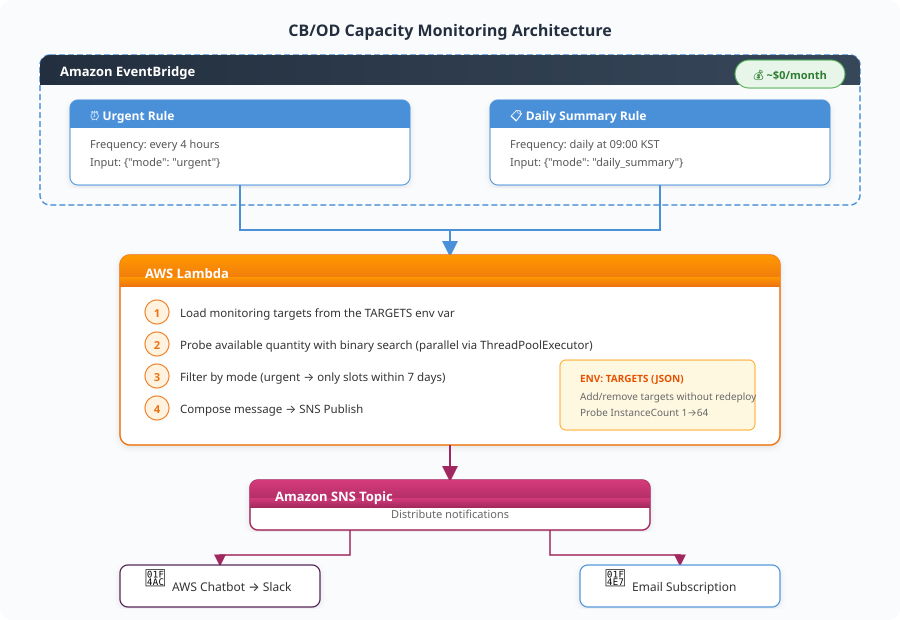
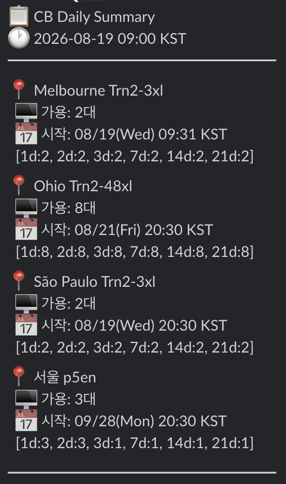

# Building a CB/OD Capacity Monitoring System

This is a guide to building a serverless system that automatically monitors the Capacity Block (CB) availability of AWS GPU instances (P5, P5en, P6-B300, Trn2, and more) and lets you receive instant notifications when an available slot appears.


## 1. Official AWS APIs

### Capacity Blocks query API

`DescribeCapacityBlockOfferings` — the **official API** for querying available CB slots.

| Item | Details |
| --- | --- |
| **Purpose** | Query reservable CB offerings for a specific instance type/region/period |
| **Cost** | Free (no API call charges) |
| **Constraint** | Can query only one InstanceCount/Duration combination at a time |
| **Documentation** | [API Reference](https://docs.aws.amazon.com/AWSEC2/latest/APIReference/API_DescribeCapacityBlockOfferings.html) |

**Key parameters:**

| Parameter | Required | Description |
| --- | --- | --- |
| `InstanceType` | ✅ | Instance type (e.g., `p5en.48xlarge`) |
| `CapacityDurationHours` | ✅ | Reservation period — in 1-day units (24-336h) or 7-day units (168-4368h) |
| `InstanceCount` | ❌ | Number of concurrent reservations (default 1, max 64) |
| `StartDateRange` | ❌ | Start-date filter (returns only offerings after this date) |

**Example response:**

```json
{
  "CapacityBlockOfferings": [
    {
      "CapacityBlockOfferingId": "cbr-offering-0abc123...",
      "InstanceType": "p5en.48xlarge",
      "AvailabilityZone": "ap-northeast-2a",
      "InstanceCount": 1,
      "StartDate": "2026-07-02T11:30:00+00:00",
      "EndDate": "2026-07-03T11:30:00+00:00",
      "CapacityBlockDurationHours": 24,
      "UpfrontFee": "998.69"
    }
  ]
}
```

**CLI example:**

```bash
aws ec2 describe-capacity-block-offerings \
  --instance-type p5en.48xlarge \
  --instance-count 1 \
  --capacity-duration-hours 168 \
  --region ap-northeast-2
```

!!! warning "You can't directly know the exact available quantity"
    The API only answers "is there a reservable offering for these conditions?" To find the exact available quantity, you have to probe with a **binary search** approach, raising the InstanceCount step by step.

### On-Demand availability estimation API

`GetSpotPlacementScores` — the official API for **indirectly estimating** the availability of On-Demand instances.

| Item | Details |
| --- | --- |
| **Purpose** | A score (1-10) for the likelihood of securing Spot capacity for a specific instance/region |
| **Cost** | Free |
| **Relationship to OD** | Spot and OD share a physical pool, so a high Spot score means OD is also more likely to be secured <br>(correlation, not a guarantee) |
| **Documentation** | [API Reference](https://docs.aws.amazon.com/AWSEC2/latest/APIReference/API_GetSpotPlacementScores.html) |

**Key parameters:**

| Parameter | Description |
| --- | --- |
| `InstanceTypes` | List of instance types (at least 3 required) |
| `TargetCapacity` | Quantity you want to secure |
| `RegionNames` | List of regions to query (up to 10) |

**CLI example:**

```bash
aws ec2 get-spot-placement-scores \
  --instance-types p5en.48xlarge p5.48xlarge p4d.24xlarge \
  --target-capacity 1 \
  --region-names ap-northeast-2 us-east-1 us-west-2
```

**Interpreting the response:**

| Score | Meaning |
| --- | --- |
| 9-10 | Almost certainly securable |
| 6-8 | High probability |
| 3-5 | Uncertain |
| 1-2 | Almost impossible |

!!! note "Limitations for GPU instances"
    GPU instances (p5, p5en, etc.) have small pools, so they almost always score 1-2 → low discriminative power. There is **no** official API that directly confirms OD available quantity.


## 2. Monitoring system architecture

### Architecture diagram




### Core logic: Binary Search Probe

To find out "exactly how many instances are available," it performs a binary search on `InstanceCount`.

```python
def binary_search_max(ec2_client, instance_type, duration_hours):
    lo, hi, best = 1, 64, 0
    now = datetime.now(timezone.utc)
    while lo <= hi:
        mid = (lo + hi) // 2
        resp = ec2_client.describe_capacity_block_offerings(
            InstanceType=instance_type,
            InstanceCount=mid,
            CapacityDurationHours=duration_hours,
            StartDateRange=now,
        )
        if resp.get('CapacityBlockOfferings', []):
            best = mid
            lo = mid + 1
        else:
            hi = mid - 1
    return best
```

- **Search range**: 1-64 (CB API maximum)
- **API calls**: Derives the exact value in up to 6 calls
- **Parallel processing**: Probes multiple regions/periods concurrently with ThreadPoolExecutor

### Notification strategy

| Mode | Frequency | Condition | Content |
| --- | --- | --- | --- |
| **Urgent** | Every 4 hours | Only when there is a slot starting within 7 days | Brief summary (instance count + start date) |
| **Daily Summary** | Daily at 09:00 | Always | Detailed available quantity by full period |

**Example Daily Summary notification:**




## 3. Cost

| Component | Monthly cost |
| --- | --- |
| Lambda (~180 runs/month, ~3 min each) | **~$0** |
| EventBridge Rules (2) | **$0** |
| SNS Publish | **$0** |
| AWS Chatbot | **$0** |
| **Total** | **~$0/month** |

!!! tip "Effectively zero cost"
    All components fall within the Free Tier. With Lambda memory at 128 MB and execution time under 3 minutes, you stay comfortably within the 1 million free invocations per month.


## 4. Configuring the TARGETS environment variable

Monitoring targets are managed through a Lambda environment variable. You can add or remove targets without redeploying.

```json
[
  {
    "instance_type": "p5en.48xlarge",
    "region": "ap-northeast-2",
    "durations": [24, 168, 336]
  },
  {
    "instance_type": "trn2.48xlarge",
    "region": "us-east-1",
    "durations": [168, 336, 672]
  }
]
```

| Field | Description |
| --- | --- |
| `instance_type` | Instance type to monitor |
| `region` | Target region |
| `durations` | List of reservation periods (hours) to query |


## 5. Add-on: CB auto-renewal management

If you need automatic renewal before a CB expires, use the AWS Solutions Library:

| Item | Details |
| --- | --- |
| **GitHub** | [guidance-for-automated-management-of-aws-capacity-blocks](https://github.com/aws-solutions-library-samples/guidance-for-automated-management-of-aws-capacity-blocks) |
| **Features** | Detect CB expiration → auto-renew → approval workflow → API management |
| **Cost** | ~$7.40/month |
| **Deployment** | AWS CDK |

!!! tip "Combining monitoring + renewal"
    - Monitoring (this system) = "notify when new CB availability is found"
    - Renewal management = "automatically renew existing CBs before they expire"
    - Running both systems together → fully automates the entire CB lifecycle


## 6. Limitations

| Item | Details |
| --- | --- |
| OD availability | No direct API. Only indirect estimation via SPS (score) |
| Per-customer limit | A per-customer concurrent reservation limit exists per instance/region |
| API Rate Limit | No problem, since a binary search is 6 calls per period |
| Supported periods | Supported periods differ by region/instance (InvalidParameterValue if unsupported) |


## Related Guides

| Guide | Content |
| --- | --- |
| [Capacity Blocks Practical Guide](../capacity-blocks-guide.md) | Step-by-step walkthrough of CB reservation/billing/console usage |
| [GPU/Trainium Purchase Options Comparison](../purchase-options/index.md) | Comparison of OD, RI, SP, CB, and Spot options |


## Reference Links

| Resource | URL |
| --- | --- |
| DescribeCapacityBlockOfferings | [API Reference](https://docs.aws.amazon.com/AWSEC2/latest/APIReference/API_DescribeCapacityBlockOfferings.html) |
| GetSpotPlacementScores | [API Reference](https://docs.aws.amazon.com/AWSEC2/latest/APIReference/API_GetSpotPlacementScores.html) |
| PurchaseCapacityBlock | [API Reference](https://docs.aws.amazon.com/AWSEC2/latest/APIReference/API_PurchaseCapacityBlock.html) |
| Capacity Blocks User Guide | [User Guide](https://docs.aws.amazon.com/AWSEC2/latest/UserGuide/capacity-blocks-purchase.html) |
| Spot Placement Score Guide | [User Guide](https://docs.aws.amazon.com/AWSEC2/latest/UserGuide/spot-placement-score.html) |
| AWS Solutions: CB automated management | [GitHub](https://github.com/aws-solutions-library-samples/guidance-for-automated-management-of-aws-capacity-blocks) |
| Spot Placement Score Tracker | [GitHub](https://github.com/aws-solutions-library-samples/guidance-for-ec2-spot-placement-score-tracker) |

*Author: Suji Lee · Accelerated Compute GTM SSA, AWS Korea*
