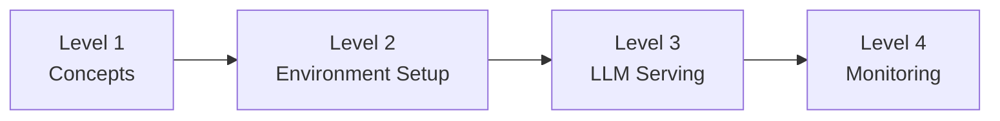

# Learning Path

A step-by-step learning guide for engineers who are new to the AWS Neuron SDK.  
It is built on the official documentation and takes you in order, from fundamental concepts to hands-on serving.

## :material-map-marker-path: Recommended Learning Order

## :material-book-open-variant: Level 1 — Concepts

> Understand what the Neuron SDK is, the Trainium hardware structure, and the overall architecture.

| # | Topic | Link | Est. Time |
|---|------|------|:---------:|
| 1 | **Neuron SDK Overview** | [:octicons-link-external-16: AWS Neuron Documentation](https://awsdocs-neuron.readthedocs-hosted.com/en/latest/){target=_blank} | 10 min |
| 2 | **Trainium2 Hardware Architecture** — NeuronCore-v3, LNC, memory hierarchy | [:octicons-link-external-16: Trainium2 Architecture](https://awsdocs-neuron.readthedocs-hosted.com/en/latest/general/arch/neuron-hardware/trainium2.html){target=_blank} | 15 min |
| 3 | **NeuronCore-v3 Architecture** — Tensor/Vector/Scalar/GPSIMD engines | [:octicons-link-external-16: NeuronCore-v3](https://awsdocs-neuron.readthedocs-hosted.com/en/latest/general/arch/neuron-hardware/neuron-core-v3.html){target=_blank} | 15 min |
| 4 | **EC2 Instance Architecture** — Trn1/Trn2 topology, NeuronLink | [:octicons-link-external-16: Neuron Architecture Guides](https://awsdocs-neuron.readthedocs-hosted.com/en/latest/general/arch/index.html){target=_blank} | 15 min |

!!! tip "If you have GPU experience"
    If you have CUDA/NVIDIA GPU experience, reading this through the lens of the differences between Trainium and GPUs will speed up your understanding.  
    Key differences: NeuronCore instead of CUDA Core, and a software-managed SRAM + HBM hierarchy instead of HBM alone.

## :material-rocket-launch: Level 2 — Environment Setup & First Run

> Connect to a Neuron environment using a DLAMI and train your first model.

| # | Topic | Link | Est. Time |
|---|------|------|:---------:|
| 5 | **Quick Start Guide** — choosing the Training / Inference / Serving path | [:octicons-link-external-16: Get Started](https://awsdocs-neuron.readthedocs-hosted.com/en/latest/general/quick-start/index.html){target=_blank} | 5 min |
| 6 | **Training Quick Start** — training your first model on Trainium | [:octicons-link-external-16: Train a Model on Trainium](https://awsdocs-neuron.readthedocs-hosted.com/en/latest/general/quick-start/training-quickstart.html){target=_blank} | 30 min |
| 7 | **PyTorch NeuronX Developer Guide** — torch-neuronx basics and how XLA works | [:octicons-link-external-16: PyTorch NeuronX Programming Guide](https://awsdocs-neuron.readthedocs-hosted.com/en/latest/frameworks/torch/torch-neuronx/programming-guide/training/pytorch-neuron-programming-guide.html){target=_blank} | 20 min |

!!! note "Prerequisites"
    - An AWS account (including EC2 access permissions)
    - Basic experience using PyTorch
    - An environment that can connect to EC2 instances over SSH

## :material-server: Level 3 — vLLM Serving

> Learn the full workflow for serving LLMs on Neuron.

| # | Topic | Link | Est. Time |
|---|------|------|:---------:|
| 8 | **vLLM on Neuron Overview** — architecture and NxD Inference integration | [:octicons-link-external-16: vLLM on Neuron](https://awsdocs-neuron.readthedocs-hosted.com/en/latest/libraries/nxd-inference/vllm/index.html){target=_blank} | 10 min |
| 9 | **Online Serving Quick Start** — running an OpenAI-compatible API server | [:octicons-link-external-16: Online Serving](https://awsdocs-neuron.readthedocs-hosted.com/en/latest/libraries/nxd-inference/vllm/quickstart-vllm-online-serving.html){target=_blank} | 15 min |
| 10 | **Offline Inference** — batch inference workflow | [:octicons-link-external-16: Offline Serving](https://awsdocs-neuron.readthedocs-hosted.com/en/latest/libraries/nxd-inference/vllm/quickstart-vllm-offline-serving.html){target=_blank} | 10 min |

## :material-chart-line: Level 4 — Monitoring & Operations Tools

> Learn how to use operations-essential tools such as `neuron-top` and `neuron-monitor`.

| # | Topic | Link | Est. Time |
|---|------|------|:---------:|
| 11 | **Neuron Top** — real-time NeuronCore/memory usage | [:octicons-link-external-16: Neuron Top User Guide](https://awsdocs-neuron.readthedocs-hosted.com/en/latest/tools/neuron-sys-tools/neuron-top-user-guide.html){target=_blank} | 10 min |
| 12 | **Neuron Monitor** — JSON metrics collection, Prometheus/Grafana integration | [:octicons-link-external-16: Neuron Monitor User Guide](https://awsdocs-neuron.readthedocs-hosted.com/en/latest/tools/neuron-sys-tools/neuron-monitor-user-guide.html){target=_blank} | 10 min |
| 13 | **EKS Monitoring** — deploying the Neuron Monitor DaemonSet | [:octicons-link-external-16: Deploy Neuron Monitor DaemonSet](https://awsdocs-neuron.readthedocs-hosted.com/en/latest/deploy/infrastructure/monitoring.html){target=_blank} | 10 min |
| 14 | **Hands-on: neuron-monitor + Prometheus + Grafana** | [:octicons-link-external-16: Tutorial: Monitoring with MNIST](https://awsdocs-neuron.readthedocs-hosted.com/en/latest/tools/tutorials/tutorial-neuron-monitor-mnist.html){target=_blank} | 30 min |

!!! tip "If you're familiar with nvidia-smi"
    `neuron-top` is the counterpart to NVIDIA GPU's `nvidia-smi`.  
    It lets you check NeuronCore utilization, memory, and loaded model information in real time.

## :material-link-variant: Additional References

| Resource | Link |
|------|------|
| AWS Neuron SDK GitHub | [:octicons-link-external-16: aws-neuron/aws-neuron-sdk](https://github.com/aws-neuron/aws-neuron-sdk){target=_blank} |
| Neuron Samples (example code) | [:octicons-link-external-16: aws-neuron/aws-neuron-samples](https://github.com/aws-neuron/aws-neuron-samples){target=_blank} |
| AWS Trainium Getting Started (official) | [:octicons-link-external-16: aws.amazon.com/trainium/getting-started](https://aws.amazon.com/ai/machine-learning/trainium/getting-started){target=_blank} |
| Neuron DLAMI Guide | [:octicons-link-external-16: DLAMI User Guide](https://awsdocs-neuron.readthedocs-hosted.com/en/latest/dlami/index.html){target=_blank} |

!!! warning "Version note"
    All links point to the Neuron SDK **latest** version. If you need documentation for a specific version, change `latest` in the URL to the version you want (for example, `v2.30.0`).
