# NDD Day 1 Lab — vLLM Deployment · Monitoring · Benchmarking

## 🎯 Lab Objectives

| # | Goal | Completion criteria |
| --- | --- | --- |
| 1 | Deploy a vLLM server on a Neuron instance and make a successful API call | Receive a response via curl/Python |
| 2 | Observe NeuronCore utilization/memory in real time with neuron-top | Confirm utilization changes under load |
| 3 | Capture a profile with Neuron Explorer & open the timeline in the UI | Identify Prefill/Decode phases |
| 4 | Run performance benchmarks with `vllm bench serve` + feel the trade-off numbers through parameter tuning | Complete the benchmark comparison table |
| 5 | Run an accuracy benchmark with `lm_eval` | Check the GSM8K acc score |

> ⏱️ **Total time** : ~80 min (Lab 0: 5 min + Lab 1: 25 min + Lab 2: 25 min + Lab 3: 25 min)

## Lab Environment

| Item | Value |
| --- | --- |
| Instance | trn2.3xlarge (Trainium2 × 1 chip, 8 NeuronCores, HBM 96GB) |
| AMI | Deep Learning AMI Neuron (Ubuntu 24.04) — Neuron SDK 2.31+ |
| vLLM | vLLM 0_21_0_1_0_0 (Public Beta) |
| Model | meta-llama/Llama-3.2-1B-Instruct |
| TP | 4 (4 logical cores, LNC=2 default) |

!!! tip "Why trn2.3xlarge + Llama-3.2-1B?"
    With the smallest Trainium2 instance + the lightest LLM combination, **compilation completes within 2–3 minutes** → you can invest most of the lab time in "understanding."


## Lab 0-A: Create an EC2 instance (reference)

> If you already have an instance ready, skip this section.

```bash
# Query the latest Neuron DLAMI AMI ID via an SSM parameter
aws ssm get-parameter \
  --region ap-southeast-4 \
  --name /aws/service/neuron/dlami/multi-framework/ubuntu-24.04/latest/image_id \
  --query "Parameter.Value" \
  --output text

# Query all DLAMIs by OS version in a specific region
aws ec2 describe-images \
  --region ap-southeast-4 \
  --owners amazon \
  --filters "Name=name,Values=*Neuron*Ubuntu 24.04*" \
  --query 'Images | sort_by(@, &CreationDate) | [].{Name:Name, ID:ImageId, Date:CreationDate}' \
  --output table
```


## Lab 0: Environment Check (5 min)


### 1. Check Neuron devices
```bash

neuron-ls
```
> Expected result: 4 NeuronCores (trn2.3xlarge: 8 physical cores, LNC=2 default → 4 logical cores)

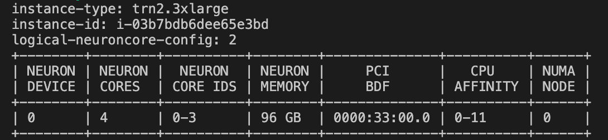

#### Checking LNC (Logical NeuronCore) — "Why TP=4?"

* trn2.3xlarge physically has **8 NeuronCores** , but under the default setting (LNC=2) they are grouped in pairs to operate as **4 logical cores** .

* Changing the LNC (Logical NeuronCore) mode changes the TP configuration:

```bash
# Change to LNC=1 (expose all 8 physical cores → 8 logical cores)
export NEURON_LOGICAL_NC_CONFIG=1
neuron-ls
# → 8 logical cores (12GB per core) → TP=8 possible
```

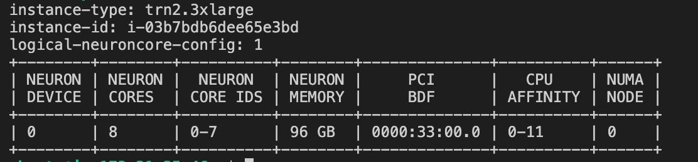


```bash
# Restore to LNC=2 (required to use TP=4 in the following labs)
export NEURON_LOGICAL_NC_CONFIG=2
neuron-ls
# → 4 logical cores (24GB per core) → TP=4

```

!!! tip "Default LNC setting LNC=2 recommended"
    HBM per core grows to 24GB so it can hold a larger KV-cache, and inter-core communication is also reduced. The difference is small on a 1B model, but LNC=2 is advantageous on larger models.

### 2. Check the installed environment
* When you launch an instance with the DLAMI, you can find pre-installed runtime libraries like the following.
```bash
ls -al /opt
```
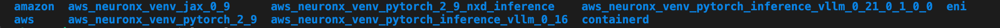


### 2. Activate the vLLM Neuron venv
* The vllm version used in today's experiment is the vLLM Neuron Plugin version currently in public beta; activate the virtual environment below.
```bash
source /opt/aws_neuronx_venv_pytorch_inference_vllm_0_21_0_1_0_0/bin/activate
```

### 3. Check versions
* In the virtual environment, check the vllm version and the neuronx-cc version.

```bash
pip show vllm | grep Version
pip show neuronx-cc | grep Version
```

### 4. Verify Neuron platform recognition
```bash
python -c "from vllm.platforms import current_platform; print(current_platform.device_name)"
# Expected output: neuron
# ⚠️ 'cuda' or an error → venv not activated or vllm-neuron not installed
```
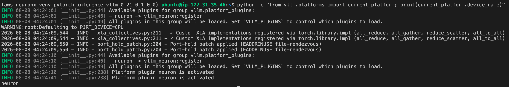


✅ **Lab 0 checkpoint** : neuron-ls shows 4 NeuronCores + vLLM version check complete


## Lab 1: Deploy the vLLM Server & Make API Calls (25 min)

!!! tip "Goal"
    Experience what "running an LLM on Neuron" actually means. Watch the compile → cache → serve flow with your own eyes.


### 1-1. Set environment variables & HuggingFace login

```bash
# Disable EFA affinity (required because trn2.3xlarge has no EFA device)
export NEURON_SKIP_EFA_AFFINITY=1

# Make it persistent
echo 'export NEURON_SKIP_EFA_AFFINITY=1' >> ~/.bashrc
source ~/.bashrc

# Compile cache setting (default location)
export VLLM_CACHE_ROOT=~/.cache/vllm

# Neuron Persistent Cache
export NEURON_COMPILE_CACHE_URL="$VLLM_CACHE_ROOT/neuron/compile_cache"
```
> VLLM_CACHE_ROOT=~/.cache/vllm → perfectly fine to omit.

> NEURON_COMPILE_CACHE_URL → an explicit setting is only needed in the following cases:

> * /var/tmp can be deleted on reboot or during OS temp-file cleanup → if the compile cache is lost, the next startup recompiles (takes tens of minutes)
> * When you need to persist the cache to a PVC in an EKS/container environment
> * When you want to manage multiple cache paths centrally in one place

* Default value of each variable

| Variable | Default |
| --- | --- |
| VLLM_CACHE_ROOT | ~/.cache/vllm |
| NEURON_COMPILE_CACHE_URL | /var/tmp/neuron-compile-cache |


* HuggingFace login
```bash
# Authentication for downloading HuggingFace models
huggingface-cli login
# Enter your HuggingFace Access Token at the prompt, or log in via browser
```

### 1-2. Start the vLLM server

```bash
NEURON_SKIP_EFA_AFFINITY=1 vllm serve meta-llama/Llama-3.2-1B-Instruct \
    --tensor-parallel-size 4 \
    --max-model-len 4096 \
    --max-num-seqs 4 \
    --max-num-batched-tokens 4096 \
    --no-enable-prefix-caching \
    --additional-config '{
      "neuron_config": {
        "num_batched_tokens_buckets": [4096],
        "num_seqs_buckets": [4]
      }
    }'

```

> ⏱️ **First run** : compilation takes ~2-3 min (NEFF generation). Subsequent runs start within tens of seconds via a cache hit.
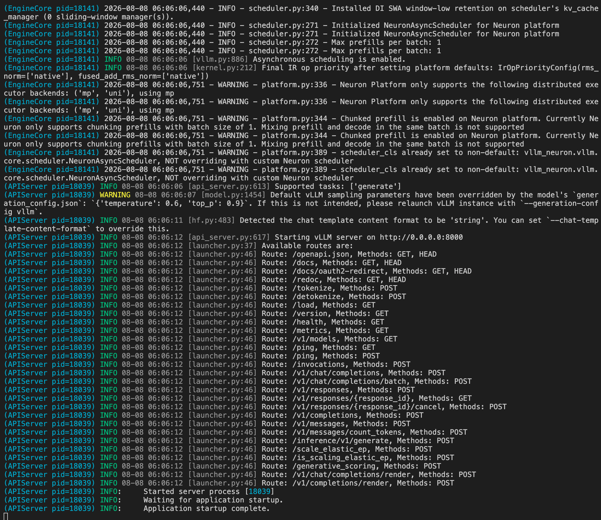


### 1-3. Parameter descriptions

| Parameter | Value | Meaning |
| --- | --- | --- |
| `--tensor-parallel-size` | 4 | Distribute the model across 4 NeuronCores |
| `--max-model-len` | 4096 | Max sequence length (determines KV-cache size) |
| `--max-num-seqs` | 4 | Max number of concurrent requests |
| `--max-num-batched-tokens` | 4096 | Max tokens processed in one iteration |
| `num_batched_tokens_buckets` | [4096] | Neuron compile bucket (static graph size) |
| `num_seqs_buckets` | [4] | Batch size bucket |
| `--no-enable-prefix-caching` | - | Disable APC (for simple lab use) |


!!! tip "APC (Automatic Prefix Caching)"
    An optimization technique that reuses already-computed KV cache to skip redundant prefill computation when requests sharing the same system prompt or a common prefix recur.

### 1-4. API call test (new terminal)
* Open a new terminal, activate the same vllm virtual environment, and run an inference test.


> CURL Test

```bash
# curl test
curl http://localhost:8000/v1/chat/completions \
  -H "Content-Type: application/json" \
  -d '{
    "model": "meta-llama/Llama-3.2-1B-Instruct",
    "messages": [{"role": "user", "content": "Hello! What is AWS neuron chip and trainium instance?"}],
    "max_tokens": 100
  }'

```

> Python SDK test

```python
# Python SDK test
from openai import OpenAI
client = OpenAI(base_url="http://localhost:8000/v1", api_key="dummy")

response = client.chat.completions.create(
    model="meta-llama/Llama-3.2-1B-Instruct",
    messages=[{"role": "user", "content": "Explain what AWS Trainium is in 2 sentences."}],
    max_tokens=100
)
print(response.choices[0].message.content)

```

✅ **Checkpoint** : the server returns a normal response (200 OK + generated text)

### 📂 Check the NEFF compile cache

When the server first starts, the Neuron Compiler compiles the model graph into NEFF (Neuron Executable File Format). On subsequent restarts with the same configuration, it loads from the cache and starts quickly.

```bash
# Check the compile cache location
ls ~/.cache/vllm/neuron/compile_cache/
# <hash>/   → each compiled graph (NEFF + HLO + metadata)
# nki/      → NKI kernel cache

# Check NEFF files (inside the hash folder)
ls ~/.cache/vllm/neuron/compile_cache/*/
# graph_<hash>.neff   ← compiled execution binary
# graph.hlo           ← HLO IR (compiler input)

# Check the total cache size
du -sh ~/.cache/vllm/neuron/compile_cache/

```

!!! tip "Cache invalidation conditions"
    Recompilation happens when `--tensor-parallel-size`, `--max-num-seqs`, `num_batched_tokens_buckets`, or the model changes, or when the Neuron SDK version is upgraded.


!!! warning "Cache storage tip"
    Using NVMe local storage (`/local`) helps with compile cache + model download speed.


!!! note "Exploring the vLLM Neuron source code"
    If you're curious about the cache logic:
    ```
    /opt/aws_neuronx_venv_pytorch_inference_vllm_0_21_0_1_0_0/lib/python3.12/site-packages/vllm_neuron/
    ├── model/       → model implementations (llama3.py, etc.)
    ├── nki/         → NKI kernels
    ├── compile/     → compile logic
    
    ```

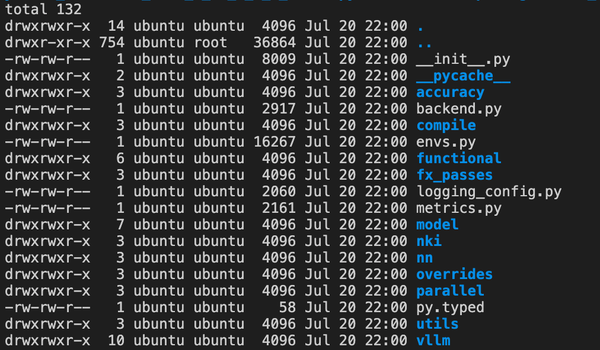

## Lab 1-B: Offline batch inference (reference)

Load the model directly and run batch inference without a server. Write and save the Python code below, then run it. Be sure to stop any running vllm server before executing.

```python
# offline_inference.py
from vllm import LLM, SamplingParams

llm = LLM(
    model="meta-llama/Llama-3.2-1B-Instruct",
    tensor_parallel_size=4,
    max_num_seqs=4,
    max_model_len=4096,
    max_num_batched_tokens=4096,
    additional_config={
        "neuron_config": {
            "num_batched_tokens_buckets": [4096],
            "num_seqs_buckets": [4]
        }
    },
)

prompts = [
    "Hello, my name is",
    "The capital of Korea is",
    "The future of AI is",
]

sampling_params = SamplingParams(max_tokens=100, temperature=0.7)
outputs = llm.generate(prompts, sampling_params)

for output in outputs:
    print(f"Prompt: {output.prompt!r}")
    print(f"Generated: {output.outputs[0].text!r}\n")

```


```bash
# Run
python offline_inference.py

```
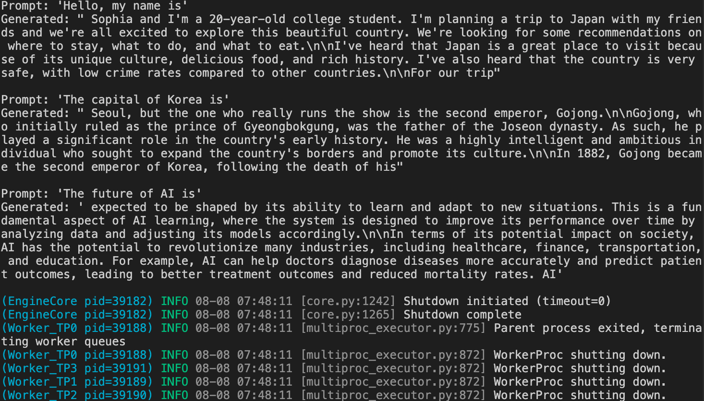

> It goes through the same compile/cache process as online serving (`vllm serve`). Use it to quickly check model behavior without server overhead.


## Lab 2: Performance Benchmarking & Accuracy Verification (25 min)

!!! tip "Goal"
    Quantitatively measure performance with `vllm bench serve`, and feel the Throughput↔Latency trade-off in numbers as parameters change. Additionally, run a model accuracy benchmark with `lm_eval`. **What you'll learn** : how to use the official benchmark CLI, a serving-SLA design mindset, the cost of adding Buckets, and the basics of accuracy verification.


### 2-1. Performance benchmarking — `vllm bench serve`

!!! note
    `vllm bench serve`: the official vLLM benchmark CLI. It sends synthetic traffic to the server and automatically measures core metrics such as TTFT, TPOT, and Throughput. On a Speculative Decoding server, it even reports the Draft Acceptance Rate.


Prepare the benchmark dataset

```bash
# Download the Sonnet benchmark dataset (official vLLM benchmark input)
wget -O sonnet.txt \
    https://raw.githubusercontent.com/vllm-project/vllm/main/benchmarks/sonnet.txt

```

## 2-2. Config A — Latency-first (restart the server after removing profiling options)

```bash
NEURON_SKIP_EFA_AFFINITY=1 vllm serve meta-llama/Llama-3.2-1B-Instruct \
    --tensor-parallel-size 4 \
    --max-model-len 4096 \
    --max-num-seqs 4 \
    --max-num-batched-tokens 4096 \
    --no-enable-prefix-caching \
    --additional-config '{
      "neuron_config": {
        "num_batched_tokens_buckets": [4096],
        "num_seqs_buckets": [4]
      }
    }'
```

```bash
# Run the Config A benchmark (vllm bench serve)
vllm bench serve \
    --base-url http://localhost:8000 \
    --model meta-llama/Llama-3.2-1B-Instruct \
    --dataset-name sonnet \
    --dataset-path ./sonnet.txt \
    --sonnet-input-len 128 \
    --sonnet-output-len 128 \
    --sonnet-prefix-len 64 \
    --num-prompts 30 \
    --max-concurrency 4 \
    --save-result \
    --result-filename config_a.json
```
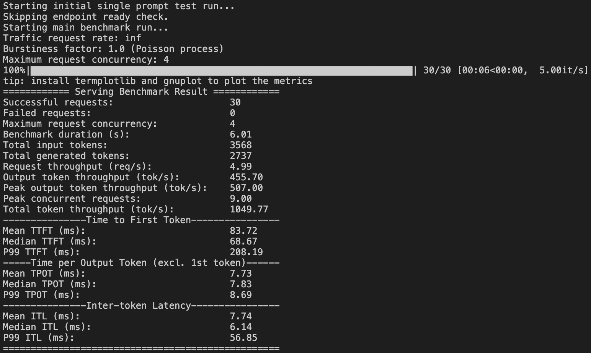

> 📝 From the results, record **TTFT (avg), TPOT (avg), Throughput (tok/s)**

### 2-3. Config B — Throughput-first (restart the server)

```bash
# Stop the server (Ctrl+C) and restart
NEURON_SKIP_EFA_AFFINITY=1 vllm serve meta-llama/Llama-3.2-1B-Instruct \
    --tensor-parallel-size 4 \
    --max-model-len 4096 \
    --max-num-seqs 16 \
    --max-num-batched-tokens 4096 \
    --no-enable-prefix-caching \
    --additional-config '{
      "neuron_config": {
        "num_batched_tokens_buckets": [4096],
        "num_seqs_buckets": [4, 8, 16]
      }
    }'
```

> --max-num-seqs 16 increases the max number of sequences that can be queued simultaneously from 4 → 16.

> * Before: process at most 4 requests at a time
> * Now: process at most 16 requests at a time
> * The more requests you batch together at once, the higher NeuronCore utilization becomes, which increases the number of tokens processed per unit time (throughput). In exchange, each request is processed together with other requests, so individual latency (TTFT, ITL) increases.


> num_seqs_buckets: [4, 8, 16] — because Neuron compiles static graphs, you must pre-build a separate NEFF (compiled graph) for each batch size.

> * Before [4] → the batch size is always fixed at 4. Even a single request is padded to a batch of 4 for execution
> * Now [4, 8, 16] → execute with the nearest bucket based on the actual number of requests (e.g., 6 requests → use the 8 bucket)
> * The more buckets you add, the more compile time and memory increase, but when requests surge you can process larger batches efficiently, improving throughput.


!!! warning "Adding a Bucket = recompilation"
    Changing `num_seqs_buckets` from [4] → [4, 8, 16] compiles a separate NEFF for each bucket. Compile time increases ~3x.


```bash
# Run the Config B benchmark (set concurrency to 16 to match the server's max_num_seqs!)
vllm bench serve \
    --base-url http://localhost:8000 \
    --model meta-llama/Llama-3.2-1B-Instruct \
    --dataset-name sonnet \
    --dataset-path ./sonnet.txt \
    --sonnet-input-len 128 \
    --sonnet-output-len 128 \
    --sonnet-prefix-len 64 \
    --num-prompts 30 \
    --max-concurrency 16 \
    --save-result \
    --result-filename config_b.json
```

### 2-4. Compare results (automation script)

```python
# compare_benchmarks.py — quantitatively compare the two Config results
import json

a = json.load(open("config_a.json"))
b = json.load(open("config_b.json"))

print(f"{'Metric':<25s} {'Config A (seqs=4)':>18s} {'Config B (seqs=16)':>18s}")
print("-" * 65)
for k in ("output_throughput", "median_tpot_ms", "median_ttft_ms"):
    print(f"{k:<25s} {a[k]:>18.2f} {b[k]:>18.2f}")

speedup = b['output_throughput'] / a['output_throughput']
print(f"\nConfig B throughput vs A: {speedup:.2f}x")

```

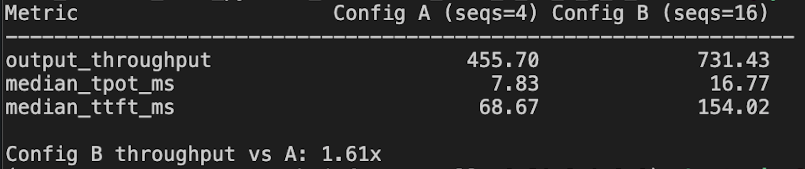

| Metric | Config A (seqs=4) | Config B (seqs=16) | Change |
| --- | --- | --- | --- |
| TTFT (avg) | ~69 ms | ~154 ms | +124% ↑ (batching contention) |
| TPOT (avg) | ~7.8 ms | ~16.8 ms | +115% ↑ (sharing within batch) |
| output_throughput | ~456 tok/s | ~731 tok/s | **+60% ↑** (more concurrent processing) |
| Compile time | ~2 min | ~6 min |  |
| Number of buckets | 1 | 3 |  |

!!! tip "Key point"
    Config B has **+60%** Throughput (more requests processed concurrently), but the TTFT/TPOT perceived by individual users **more than doubles**. You must match `--max-concurrency` to the server's `max_num_seqs` for the real difference to show up (set both to 4 and you get identical results!).


### 2-5. Thinking about real-world application

| Scenario | Recommended setting | Reason |
| --- | --- | --- |
| Chatbot (real-time conversation) | seqs=4~8, minimal buckets | Latency-first — user-perceived TTFT < 500ms |
| Batch processing (document summarization) | seqs=16~32, many buckets | Throughput-first — cost efficiency |
| API service (with SLA) | seqs=8~12, intermediate | TTFT P95 < 1s + adequate throughput |

!!! tip "Key takeaway"
    On Neuron, because a Bucket creates a fixed-size NEFF, bucket design is SLA design. Unlike GPUs that dynamically grow batches, you must **decide in advance which load patterns to support**.


✅ **Checkpoint** : run `compare_benchmarks.py` to compare the numbers of the two Configs + understand the trade-off

### 2-6. Accuracy benchmarking — `lm_eval`

!!! note
    `lm_eval`: Eleuther AI's Language Model Evaluation Harness. It connects to a vLLM server as the backend and measures model accuracy on standard tasks such as GSM8K and MMLU. Essential for verifying accuracy after quantization or TP changes.


```bash
# Check the list of available tasks
lm_eval --tasks list
# Major tasks: gsm8k, mmlu, hellaswag, arc_easy, arc_challenge, winogrande, boolq, piqa
# ⚠️ logprobs-based tasks (mmlu, arc, etc.) are limited on the Neuron backend.
#    Generative-style tasks such as gsm8k and hellaswag are recommended.

```

```bash
# Install lm_eval (skip if already in the venv)
pip install lm-eval --quiet

```

```bash
# Run the accuracy benchmark while the Config A server is running
lm_eval --model local-completions \
    --model_args model=meta-llama/Llama-3.2-1B-Instruct,base_url=http://localhost:8000/v1/completions,num_concurrent=4,tokenized_requests=False \
    --tasks gsm8k \
    --batch_size auto \
    --output_path ./accuracy_results/ \
    --log_samples

```

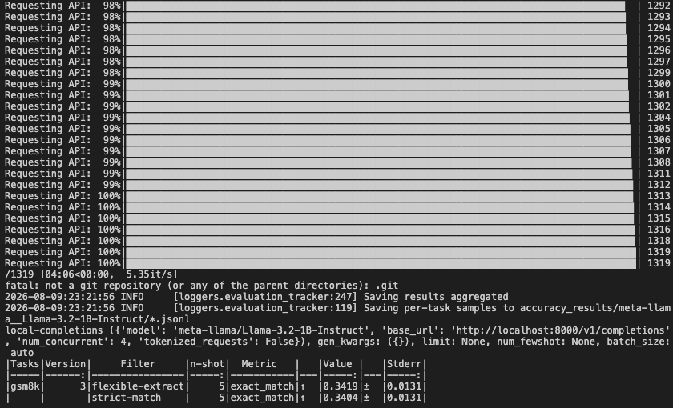

!!! tip "Interpretation guide"
    | Metric | Meaning | Reference |
    | --- | --- | --- |
    | `acc` / `acc_norm` | Accuracy | Within ±2% of the HuggingFace public leaderboard |
    | `exact_match` | Exact match | ~33-36% on GSM8K (for a 1B model) |


**Expected result (Llama-3.2-1B-Instruct, GSM8K 5-shot, trn2.3xlarge)**:

|Tasks|Version|     Filter     |n-shot|  Metric   |   |Value |   |Stderr|
|-----|------:|----------------|-----:|-----------|---|-----:|---|-----:|
|gsm8k|      3|flexible-extract|     5|exact_match|↑  |0.3419|±  |0.0131|
|     |       |strict-match    |     5|exact_match|↑  |0.3404|±  |0.0131|


!!! tip "Key point"
    Because it's a 1B model the absolute score is low, but what matters is that it produced **the same score as the GPU reference** (Meta's official ~33-36%) — this verifies that Neuron compilation does not affect model accuracy.

    ⏱️ **Time taken** : 1,319 problems × 5-shot ≈ 4 min (~5.35 it/s)


!!! warning "Note on the 1B model"
    Llama-3.2-1B is a small model, so its GSM8K score is not high. The goal here is **to learn the accuracy benchmark workflow**. In practice you use it on 70B+ models to compare before/after quantization (FP8 KV, MXFP4).


!!! tip "Real-world use scenarios"
    - Compare accuracy before and after quantization (BF16 → FP8 KV cache)
    - Verify numerical precision following TP changes
    - Verify accuracy against the HuggingFace leaderboard when onboarding a model
    - Regression testing after upgrading to a new Neuron SDK version


✅ **Checkpoint** : `lm_eval` run complete + check the `acc` score in the result file


## Lab 3: Monitoring & Profiling (25 min)

!!! tip "Goal"
    See real-time state with neuron-top and distinguish Prefill/Decode phases with Neuron Explorer. **What you'll learn** : the meaning of NeuronCore utilization, KV-cache memory changes, and reading a profile timeline


### 3-1. Real-time observation with neuron-top (terminal 2)

```bash
neuron-top

```

Observation points:

| Item | Meaning |
| --- | --- |
| NeuronCore utilization (%) | The ratio at which a core is actually computing |
| vCPU Utilization | CPU usage |
| Device Used Memory (MB) | HBM usage — roughly fixed after model load, grows with KV-cache during requests |

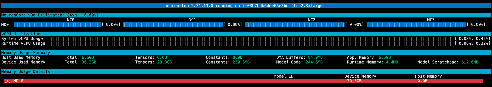

### 3-2. Generate load & observe changes (terminal 3)

```bash
# Observe changes with a single request
curl -s http://localhost:8000/v1/chat/completions \
  -H "Content-Type: application/json" \
  -d '{
    "model": "meta-llama/Llama-3.2-1B-Instruct",
    "messages": [{"role": "user", "content": "Write a detailed essay about cloud computing architecture, including IaaS, PaaS, and SaaS layers."}],
    "max_tokens": 512
  }'

```
Observe in neuron-top:

- **Before the request** : NeuronCore utilization ~0%, Memory fixed (model weights only)
- **The moment of Prefill** : utilization spike (short and high)
- **During Decode** : utilization stays at a medium level (repetitive pattern)
- **After completion** : utilization returns to 0%, KV-cache released from Memory

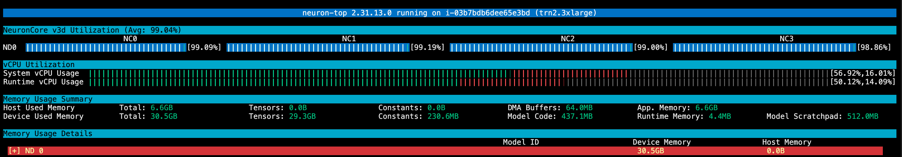

✅ **Checkpoint** : confirmed the utilization change pattern in neuron-top while a request was being processed


### 3-3. Capture a vLLM Neuron profile

!!! tip
    The vLLM Neuron Plugin captures profiles via an **HTTP endpoint approach**. Without restarting the server, you can capture precisely the segment you want from a running server. 📖 [Official docs: How to profile vLLM Neuron workloads](https://awsdocs-neuron.readthedocs-hosted.com/en/latest/vllm-neuron/docs/guides/how-to-profile-workloads.html)


**Step 0: Set environment variables for profiling**
```bash
# For the Operator Table + HLO stats (inserts metadata into the NEFF at compile time)
export XLA_IR_DEBUG=1
export XLA_HLO_DEBUG=1

# If you need NKI source-code mapping (optional)
export NEURON_FRAMEWORK_DEBUG=1

# For detailed DMA data (during runtime capture) -> may cause overflow, so unset it
unset NEURON_RT_ENABLE_DGE_NOTIFICATIONS
```

**Step 1: Start the server with profiling enabled**

```bash
# After stopping the existing server, add --profiler-config and restart
NEURON_SKIP_EFA_AFFINITY=1 vllm serve meta-llama/Llama-3.2-1B-Instruct \
    --tensor-parallel-size 4 \
    --max-model-len 4096 \
    --max-num-seqs 4 \
    --max-num-batched-tokens 4096 \
    --no-enable-prefix-caching \
    --profiler-config '{"profiler": "cuda"}' \
    --additional-config '{
      "neuron_config": {
        "num_batched_tokens_buckets": [4096],
        "num_seqs_buckets": [4]
      },
      "neuron_profiler": {
        "activities": ["all"],
        "neuron_cores": [0, 1, 2, 3],
        "output_dir": "/home/ubuntu/neuron-profiles"
      }
    }'
```

!!! warning "Key point"
    You must have `--profiler-config '{"profiler": "cuda"}'` for the `/start_profile` and `/stop_profile` HTTP endpoints to be mounted. If you start without this flag, the profile API won't work.


> `neuron_profiler` configuration reference

| Field | Type | Default | Description |
| --- | --- | --- | --- |
| `activities` | list[str] | `["device_profile", "system_profile"]` | Profile types to capture |
| `neuron_cores` | list[int] | null | null (rank 0 only) |
| `output_dir` | str | `~/neuron-profiles` | Output directory |
| `sys_trace_max_events_per_nc` | int | null | null (NRT default) |

> `activities` **valid values** : `"system_profile"`, `"device_profile"`, `"host_memory"`, `"cpu_util"`, `"all"`

**Step 1-Advanced: Iteration control — skipping warmup (comment for actual lab use)**

```bash
# delay_iterations: skip N forward passes before starting capture
# max_iterations: automatically stop after N forward passes
# → lets you cleanly skip the warmup (compile/cache) phase
NEURON_SKIP_EFA_AFFINITY=1 vllm serve meta-llama/Llama-3.2-1B-Instruct \
    --tensor-parallel-size 4 \
    --max-model-len 4096 \
    --max-num-seqs 4 \
    --max-num-batched-tokens 4096 \
    --no-enable-prefix-caching \
    --profiler-config '{"profiler": "cuda", "delay_iterations": 0, "max_iterations": 5}' \
    --additional-config '{
      "neuron_config": {
        "num_batched_tokens_buckets": [4096],
        "num_seqs_buckets": [4]
      },
      "neuron_profiler": {
        "activities": ["all"],
        "neuron_cores": [0, 1, 2, 3],
        "output_dir": "/home/ubuntu/neuron-profiles"
      }
    }'
```


| Setting | Behavior |
| --- | --- |
| `delay_iterations` | After /start_profile, skip N execute_model calls before actual capture begins |
| `max_iterations` | After capture begins, automatically /stop_profile after N execute_model calls |

!!! tip
    One iteration = one `execute_model` call (one batched forward pass)


**Step 2: Start the profile (terminal 2)**

After the server reaches the Ready state:

```bash
# Start profile capture
curl -X POST http://localhost:8000/start_profile

```

**Step 3: Send a request**

```bash
# Send 1 request during profiling (capture a clean single Prefill→Decode pattern)
curl -s http://localhost:8000/v1/chat/completions \
  -H "Content-Type: application/json" \
  -d '{
    "model": "meta-llama/Llama-3.2-1B-Instruct",
    "messages": [{"role": "user", "content": "Write a detailed step-by-step guide on how to make chocolate cake from scratch. Include all ingredients and measurements."}],
    "max_tokens": 64
  }'

```

!!! tip "Why run only 1 request"
    The purpose of profile analysis is to trace "how a single request flows through Prefill→Decode" per engine. Overlapping multiple requests makes the timeline complex and hard to analyze for teaching.

* When you set the activity to `all`, the longer the command runs the more the profile data grows, so run the commands in one shot as below to execute them sequentially and stop immediately afterward.

```bash
curl -X POST http://localhost:8000/start_profile \
&& curl -s http://localhost:8000/v1/chat/completions \
  -H "Content-Type: application/json" \
  -d '{
    "model": "meta-llama/Llama-3.2-1B-Instruct",
    "messages": [{"role": "user", "content": "Write a detailed step-by-step guide on how to make chocolate cake from scratch. Include all ingredients and measurements."}],
    "max_tokens": 5
  }' \
&& curl -X POST http://localhost:8000/stop_profile
```


**Step 4: Stop the profile**

```bash
# Stop profile capture → flush files
curl -X POST http://localhost:8000/stop_profile

```


**Step 5: Check the output**

```bash
ls ~/neuron-profiles/
# If normal, you'll see an i-<instance>_pid_<pid>/ directory and a neffs/ folder

```

Profile Output Structure

```
~/neuron-profiles/
├── i-<instance_id>_pid_<pid>/
│   └── <timestamp>/
│       ├── profile_nc_0_session_0.ntff    # Device Profile (NTFF)
│       ├── ntrace.pb                      # System trace
│       ├── trace_info.pb                  # Trace metadata
│       ├── cpu_util.pb                    # CPU utilization (if included in activities)
│       └── host_mem.pb                    # Host memory (if included in activities)
└── neffs/
    ├── graph_<hash1>.neff                 # Compiled NEFF (auto-copied from the compile cache)
    └── graph_<hash2>.neff

```

* Check that the folder is created correctly and that the capture was performed properly a second time, before starting the server.
* If you see summary data like the following, the profile is in a working state.
```
neuron-explorer view -d neuron-profiles --output-format summary-text

s_2b34ee2866d9218f6a487d2535f8008b7e887e99
    total_duration_ns    1786270865722793417
    message_count:
        Cpu_Util_Message_Count          0
        Host_Mem_Usage_Message_Count    0
        Trace_Events_Message_Count      9634
    event_type_count:
        kbl_exec_post                         20
        nrta_execute_schedule                 20
        nrt_tensor_free                       4800
        cc_exec_barrier                       20
        notification_consume_errors           40
        nrt_tensor_write                      280
        kbl_exec_wait                         20
        exec_consume_gpsimd_stdio             40
        nrt_dma_mem_alloc                     982
        nrt_tensor_allocate                   340
        dmem_buf_copyin                       1082
        kbl_exec_pre                          20
        nrt_profile_add_node_info             20
        exec_consume_cc_core_notifications    20
        nrt_dma_mem_dealloc                   460
        nrt_model_submit                      20
        cc_running                            720
        nc_exec_running                       40
        nrt_tensor_read                       305
        dmem_buf_copyout                       385
n_7792fe1daf87c456c04c96497296393233c1c7b1
    activate_instruction_count                        5220
    throttle_activity_0_avg_util_limit_nc4_percent    1
    adjusted_hardware_flops                           161563672576
    hardware_dynamic_dma_size_percent                 0.041778316085653945
    throttle_gpio_1_active_time_nc4_percent           0.005344930435136431
    throttle_active_nc5_time_ns                       22297550

```

| File | Description |
| --- | --- |
| `.ntff` | Neuron Trace File Format — per-NeuronCore hardware execution trace |
| `.neff` (inside neffs/) | Neuron Executable File Format — required for Explorer to render the Device Profile |
| `ntrace.pb` | System-level runtime events (API calls, model load, execution) |
| `trace_info.pb` | System trace metadata |
| `cpu_util.pb` | CPU utilization (when activities include `"cpu_util"` or `"all"`) |
| `host_mem.pb` | Host memory (when activities include `"host_memory"` or `"all"`) |

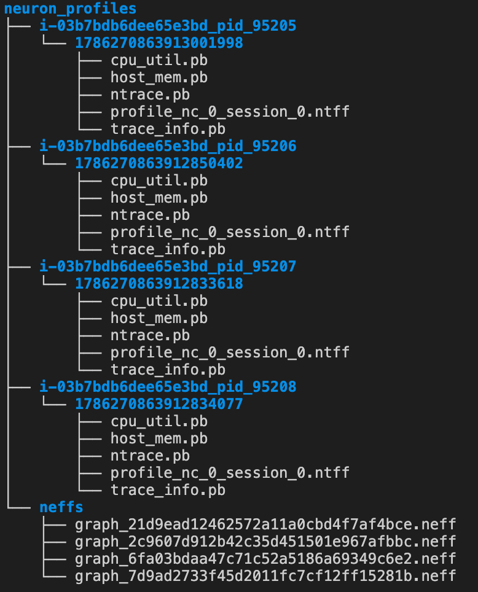

> ℹ️ **NEFF auto-copy** : vLLM Neuron automatically copies the NEFF from the compile cache into the `neffs/` folder on `/stop_profile`. If it's missing, check the `VLLM_CACHE_ROOT` path (`$VLLM_CACHE_ROOT/neuron/compile_cache`).

!!! warning "Capture-failure troubleshooting"
    | Symptom | Cause | Fix |
    | --- | --- | --- |
    | No profile output | `--profiler-config` not set | Check the flag when starting the server |
    | System trace empty or truncated | Ring buffer overflow | Increase the `sys_trace_max_events_per_nc` value |
    | Device Profile won't render in Explorer | NEFF file missing | Check the `neffs/` folder, check the compile cache path |
    | No activity in the profile | No request sent between start/stop | Call stop after sending load |


✅ **Checkpoint** : confirm the `i-*_pid_*/` directory + `neffs/` folder in `ls ~/neuron-profiles/`


### 3-4. Open the Neuron Explorer UI

Set up an SSH tunnel (run on your local machine)

```bash
ssh -i ~/key.pem -L 3001:localhost:3001 -L 3002:localhost:3002 ubuntu@<ip> -fN

```

> ℹ️ Port 3001 = Web UI, port 3002 = API Backend. **Both ports must be tunneled** — if you open only one, the page loads but no data is displayed.

Run the Explorer server (on EC2)

```bash
neuron-explorer view -v 2 -d /home/ubuntu/neuron-profiles --display-name "lab1-vllm-profile"
# → "View a list of profiles at http://localhost:3001/"
# → ctrl-c to exit
```

!!! warning
    `--display-name` **is required.** If you omit it you get the error `FATA[0000] Missing --display-name`.


**Browser** → `http://localhost:3001`

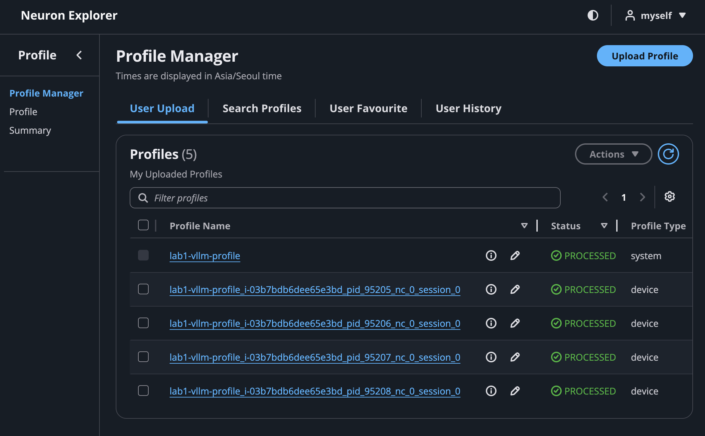

Path level — how deep should you point?

Point to the top-level `neuron-profiles/` directory. Explorer automatically scans the child PID folders + `neffs/`.

```
neuron-explorer view -v 2 -d ~/neuron-profiles
                         ^^^^^^^^^^^^^^^^^^
                         this level (the parent of the PID folder)

```

Neuron Explorer UI structure

| View | Contents | What you see |
| --- | --- | --- |
| **System Profile** | Host-side Runtime API call timeline | nrt_execute, tensor_write/read, model load |
| **Device Profile** | Per-engine execution timeline inside the NeuronCore | Tensor/Vector/Scalar/DMA Engine busy/idle |

**The VS Code extension's data-path**

```bash
/home/ubuntu/.vscode-server/data/User/globalStorage/amazonwebservices.neuron-explorer/data
```

**CLI default path:**

```bash
/home/ubuntu/.local/share/neuron-explorer
```

### Delete failed profiles (reset)

```bash
# VS Code extension side
rm -rf /home/ubuntu/.vscode-server/data/User/globalStorage/amazonwebservices.neuron-explorer/data/*

# CLI side
rm -rf /home/ubuntu/.local/share/neuron-explorer/*
```

### 2-5. Profile analysis

Step 1: System Profile — "when did what happen"

The System Profile is **the timeline as seen from the host**. The `nrt_execute` events are the key:

| Event | Meaning |
| --- | --- |
| `nrt_execute` (long, one) | **Prefill** — process all input tokens at once |
| `nrt_execute` (short, repeated) | **Decode** — generate one token at a time |
| `nrt_tensor_write` | Host→device tensor transfer |
| `nrt_tensor_read` | Device→host tensor read |
| `nrt_load_collectives` | Load collective ops such as AllReduce |

> 🔍 **How to find it** : in Perfetto click `nrt_execute` → Arguments panel → in the `model_name` field check `context_encoding_model` (= Prefill) or `token_generation_model` (= Decode)

Step 2: Device Profile — "what was busy and what was idle inside the core"

When you open the Device Profile in the Neuron Explorer UI, you see **a per-engine timeline**:

| Engine | Role | Normal state |
| --- | --- | --- |
| **Tensor Engine** | Matrix multiply (GEMM) | Continuously busy during Prefill |
| **Vector Engine** | Activation, Norm | Short bursts |
| **Scalar Engine** | Control flow | Barely visible |
| **DMA Engine** | HBM↔SBUF data movement | Continuously busy during Decode |

Step 3: Bottleneck-diagnosis checklist

| Symptom | What you see in the profile | Meaning | Action |
| --- | --- | --- | --- |
| High TTFT | Gaps (empty space) in TensorE during the Prefill phase | DMA can't deliver data in time | Optimize NKI tiling |
| High TPOT | Idle periods after DMA during the Decode phase | AllReduce wait or insufficient batch | Increase batch |
| Slow overall | Long gaps between `nrt_execute` | Host scheduling overhead | Simplify buckets |

!!! tip "Key insight"
    Prefill = Compute-bound (abnormal if TensorE is idle), Decode = Memory-bound (abnormal if DMA is idle). This is confirming the Roofline you learned in Session 3 on an actual profile.


✅ **Checkpoint** : identified the Prefill→Decode transition pattern in Explorer + confirmed the per-engine busy/idle periods


## Wrap-up (5 min)

### What we confirmed in today's lab

| # | Item confirmed | ✅ |
| --- | --- | --- |
| 1 | Successfully deployed an LLM server with vLLM + Neuron |  |
| 2 | Observed NeuronCore utilization/memory changes in neuron-top |  |
| 3 | Captured a profile & opened the timeline in Neuron Explorer |  |
| 4 | Identified the Prefill (long, one) vs Decode (short, repeated) pattern |  |
| 5 | Completed a quantitative Config A/B performance comparison with `vllm bench serve` |  |
| 6 | Ran the accuracy benchmark workflow with `lm_eval` |  |


## Reference: In-depth accuracy verification (used in the Day 3 lab)

!!! tip
    In Day 1 you checked E2E accuracy with `lm_eval`. In Day 3 you'll cover in-depth accuracy debugging such as CPU-mode debugging, 3-Way tensor comparison, and module-level unit tests.


```python
# Compare deterministic outputs with greedy decode
from vllm import LLM, SamplingParams

llm = LLM(
    model="meta-llama/Llama-3.2-1B-Instruct",
    tensor_parallel_size=4,
    max_num_seqs=4,
    max_model_len=4096,
    max_num_batched_tokens=4096,
    additional_config={
        "neuron_config": {
            "num_batched_tokens_buckets": [4096],
            "num_seqs_buckets": [4]
        }
    },
)

prompts = ["The capital of France is"]
params = SamplingParams(temperature=0, max_tokens=50)  # greedy
output = llm.generate(prompts, params)
print(output[0].outputs[0].text)
# Same output every run → deterministic verification possible

```


*Author: Suji Lee · GTM XC Specialist SA, APJ AI Infrastructure*
